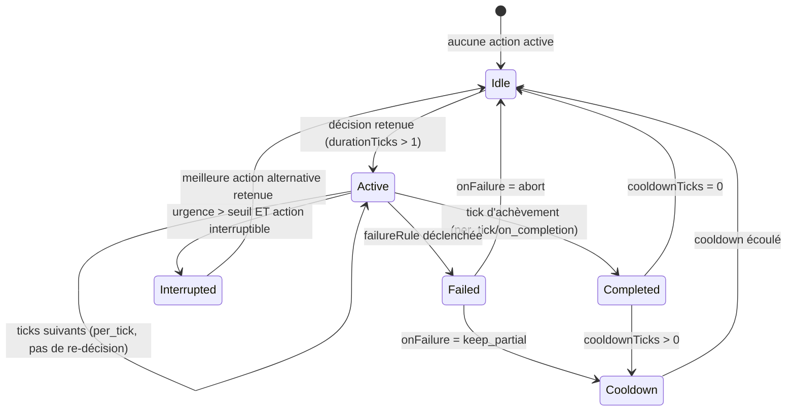
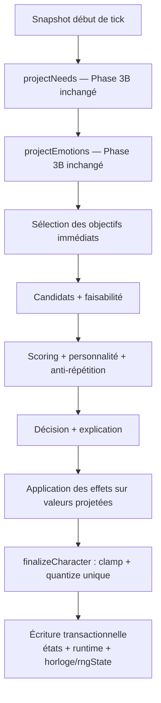

# Système d'actions autonomes — conception Phase 3C

> **Statut : implémenté (tranche 3).** Catalogue versionné, machine à états, effets
> numériques et persistance atomique du runtime sont branchés sur le tick. Aucune IPC,
> aucun renderer, aucun worker ni appel LLM n'est modifié. Le document ci-dessous
> conserve l'audit et la conception d'origine.
> Source de vérité de l'existant : `src/shared/character.ts`, `src/shared/simulation-rules.ts`,
> `src/main/services/character-tick.service.ts`, `src/main/services/world-store.service.ts`,
> `docs/CHARACTER_TICK_RULES.md`.

## 1. Audit de l'existant (vérifié dans le code)

| Élément | État réel | Conséquence pour la conception |
|---|---|---|
| `CharacterState` | `traits` (21), `emotions` (10), `needs` (8), `goals` (1 principal + 2 secondaires). | Aucun champ `action`, `location`, `inventory`, `resource` ou `relationship` n'existe. |
| `CharacterTickSnapshot` | `characterId`, `traits`, `needs`, `emotions`, `goals` en lecture seule. | Le snapshot d'action doit être **étendu** (additif) avec un runtime d'action ; aucun autre contexte n'est disponible. |
| `computeCharacterTick()` | Orchestration pure : `projectNeeds` → `projectEmotions` → `finalizeCharacter`. | Les effets d'action doivent s'appliquer aux **valeurs projetées**, avant la quantification finale unique. |
| `writeTickCharacterStates()` | Écrit `emotions_json`/`needs_json` + miroirs `current_*`, `updated_at`. | Aucune écriture d'action aujourd'hui ; l'ajout futur doit rester dans la même transaction. |
| `SimulationClock.rngState` | uint32 mulberry32, conservé tel quel en Phase 3B. | La Phase 3C peut le consommer **uniquement** avec un protocole documenté et rejouable (voir `AUTONOMOUS_DECISION_SYSTEM.md` §9). |
| `lastProcessedOrder` | Toujours 0. | Aucun ordre intra-tick d'action n'existe ; l'ordre sera déterminé par le tri des identifiants. |
| Aucun environnement | Aucune table/colonnes `locations`, `objects`, `resources`, `events`, `relationships`, `memories`. | Les actions dépendantes d'un environnement sont **classées [Reporté]** et non simulées. |
| `SeededRng` | `next()`, `int()`, `pick()`, `chance()`, `getState()`, `setState()`. | Disponible pour un départage éventuel, jamais pour inventer un contexte absent. |

## 2. Périmètre

### Inclus dans la conception
- Catalogue extensible d'actions avec identifiant stable, description, préconditions,
  besoins satisfaits, coûts, durée en ticks, effets émotionnels, conséquences attendues,
  interruption, échec et anti-répétition.
- Distinction **actions immédiatement réalisables** / **actions nécessitant une phase
  environnementale future**.
- Machine à états d'une action longue, sans blocage de l'évolution passive des
  besoins/émotions.
- Contrats TypeScript proposés et scénarios de tests futurs.

### Exclus / reportés
- Création de lieux, objets, ressources partagées, inventaire, relations, événements,
  souvenirs, mort ou dialogue.
- Toute dépendance au LLM (interdite pour la décision et les conséquences).
- Modification du code, du schéma SQLite ou de l'UI.

## 3. Principes directeurs (décisions définitives de structure)

1. **Aucune action n'invente de contexte.** Une action ne peut référencer que les données
   du tick : traits, besoins, émotions, objectifs, heure du tick et présence d'un autre
   personnage (déduite de `characters.length > 1` dans `CharacterTickInput`, injectée dans
   le snapshot étendu). Toute dépendance extérieure est déclarée et désactivée.
2. **Action = effet sur l'état du personnage**, pas sur le monde. En Phase 3C, une action
   modifie des valeurs projetées du personnage qui l'exécute ; elle ne modifie ni un autre
   personnage, ni une ressource, ni une relation (aucune n'existe).
3. **Effet attendu ≠ effet appliqué.** Le catalogue déclare des effets nominaux utilisés
   par le scoring ; l'application réelle est bornée par la marge disponible, modulée par
   les traits et tracée dans l'explication.
4. **Une seule quantification par tick.** Les effets d'action sont intégrés avant
   `finalizeCharacter()` ; on n'arrondit jamais deux fois.
5. **Application différée.** Aucune action n'est appliquée pendant la phase de décision :
   tous les personnages décident depuis le même snapshot.
6. **Catalogue immuable au runtime.** Les définitions sont statiques, versionnées et
   enregistrées ; l'état mutable est uniquement le runtime par personnage.

## 4. Catalogue proposé

> Les valeurs numériques sont des **hypothèses configurables** (comme les coefficients
> Phase 3B), pas des décisions définitives. Les décisions définitives portent sur la
> structure, le classement par disponibilité et les règles d'application.

Légende des tiers :
- **A — immédiatement réalisable** : aucune donnée extérieure au personnage (ou simple
  présence d'un autre personnage, déjà persistée) n'est requise.
- **B — nécessite une phase environnementale** : la précondition est déclarée mais
  **jamais satisfaite aujourd'hui** ; l'action reste dans le catalogue comme contrat,
  sans jamais être sélectionnée.

| id | Libellé FR | Tier | Durée (ticks) | Gains nominaux (par tick sauf `on_completion`) | Coûts | Effets émotionnels | Cooldown | Catégorie |
|---|---|---|---:|---|---|---|---:|---|
| `eat` | Manger | A | 1 | `hunger +25` (`on_completion`) | `energy −1` | `satisfaction +2`, `happiness +1` | 2 | `sustenance` |
| `drink` | Boire | A | 1 | `thirst +30` (`on_completion`) | `energy −0.5` | `satisfaction +1` | 2 | `sustenance` |
| `sleep` | Dormir | A | 8 | `sleep +8`, `energy +3` (`per_tick`) | `hunger −0.3`, `thirst −0.4`, `hygiene −0.1` | `stress −1`, `anxiety −0.5` | 4 | `rest` |
| `rest` | Se reposer | A | 2 | `energy +4`, `sleep +3` (`per_tick`) | — | `stress −1.5`, `anxiety −0.5` | 1 | `rest` |
| `wash` | Se laver | **B** | 1 | `hygiene +30` (`on_completion`) | `energy −1` | `happiness +1`, `stress −1` | 3 | `hygiene` |
| `entertain_self` | Se divertir | A | 2 | `socialization +2` (`per_tick`) | `energy −0.5` | `happiness +2`, `stress −1.5`, `loneliness −1` | 2 | `leisure` |
| `explore` | Explorer | **B** | 4 | — (découverte non modélisée) | `energy −1.5`, `safety −0.5` | `happiness +1`, `stress +0.5` | 4 | `exploration` |
| `practice_activity` | Pratiquer une activité | **B** | 4 | — (compétence non modélisée) | `energy −1` | `happiness +1`, `confidence +1`, `motivation +1` | 3 | `leisure` |
| `be_alone` | Rester seul | A | 2 | `energy +1` (`per_tick`) | `socialization −1` | `stress −1`, `anxiety −0.5` | 2 | `social` |
| `seek_company` | Rechercher de la compagnie | A* | 2 | `socialization +4` (`per_tick`) | `energy −0.5` | `loneliness −2`, `happiness +1` | 3 | `social` |
| `idle` | Ne rien faire | A | 1 | — | — | — | 0 | `fallback` |

\* `seek_company` est réalisable dès qu'**au moins un autre personnage existe dans le
monde** (donnée réellement persistée). Aucun événement de rencontre, aucune relation et
aucune interaction entre personnages n'est créé : l'effet est strictement **auto-appliqué**
au personnage qui décide. [Reporté] interactions futures.

### 4.1 Hypothèses explicites sur les actions Tier A

- `eat` / `drink` ne référencent **aucun objet ni ressource**. Le gain est appliqué
  directement au besoin. C'est une **hypothèse de simulation** (« subsistance minimale non
  modélisée »), pas une affirmation qu'un garde-manger ou une source d'eau existe.
  [Hypothèse provisoire] Si un système de ressources est introduit plus tard, ces actions
  basculent en Tier B via `environmentRequirement`, sans changer leur identifiant.
- `sleep` suppose un repos possible sur place ; aucun lit ni lieu n'est modélisé.
- `entertain_self` est une distraction mentale abstraite ; les formes concrètes (lire,
  musique, jeu) nécessiteront des objets/compétences et seront des variantes Tier B.
- `be_alone` réduit la socialisation : c'est un coût réel, pas un effet positif déguisé.
  Le scoring le pénalisera donc quand la socialisation est déjà basse.

### 4.2 Actions Tier B — raisons du report

| id | Précondition environnementale manquante | Pourquoi ce n'est pas simulé aujourd'hui |
|---|---|---|
| `wash` | `environment: washing_facility` | Aucun point d'eau, salle ni objet n'existe dans le schéma. |
| `explore` | `environment: locations` | Aucun lieu, carte ou déplacement n'existe. |
| `practice_activity` | `environment: activity_definition` | Aucun type d'activité, outil ni compétence n'existe. |

Le registre conserve ces définitions avec `availability: 'requires_environment'` ; la
fonction d'évaluation retourne `feasible: false` et `reason: 'environment_unavailable'`.
**Aucune de ces actions ne peut être sélectionnée tant que la phase environnementale
n'est pas implémentée.**

## 5. Influence de la personnalité (règles testables)

Chaque action porte une table `traitAffinity : Partial<Record<TraitKey, number>>`. Le
multiplicateur utilise **le helper existant** `traitMultiplier()` de
`personality-influence.service.ts` : produit `Π(1 + k * traitFactor)` borné dans `[0.5, 1.5]`.
Le terme de score est `(multiplier − 1) * TRAIT_WEIGHT`, donc dans `[-0.125, +0.125]`
avec `TRAIT_WEIGHT = 0.25`. Aucun trait n'est ajouté au modèle.

| Action | Traits favorables (k > 0) | Traits défavorables (k < 0) |
|---|---|---|
| `eat`, `drink` | `discipline +0.05` | `impulsivity −0.05` |
| `sleep` | `discipline +0.10` | `impulsivity −0.10` |
| `rest` | `patience +0.10` | `impulsivity −0.10` |
| `wash` | `discipline +0.10` | `impulsivity −0.05` |
| `entertain_self` | `humor +0.15`, `creativity +0.10` | `discipline −0.05` |
| `explore` | `curiosity +0.20`, `courage +0.15` | `timidity −0.15`, `distrust +0.05` |
| `practice_activity` | `creativity +0.20`, `ambition +0.15`, `discipline +0.10` | — |
| `be_alone` | `independence +0.20` | `sociability −0.20` |
| `seek_company` | `sociability +0.20`, `empathy +0.10` | `independence −0.15`, `timidity −0.10` |
| `idle` | — | — |

Propriétés testables :
- deux personnages avec les mêmes besoins/émotions mais des traits différents doivent
  pouvoir choisir des actions différentes ;
- le multiplicateur reste dans `[0.5, 1.5]` pour des traits à 0 ou 100 ;
- une action sans affinité (`idle`) a un multiplicateur exactement égal à 1.

## 6. Préconditions et faisabilité

```ts
export type ActionPrecondition =
  | { kind: 'need_below'; need: NeedKey; threshold: number }
  | { kind: 'need_above'; need: NeedKey; threshold: number }
  | { kind: 'emotion_above'; emotion: EmotionKey; threshold: number }
  | { kind: 'emotion_below'; emotion: EmotionKey; threshold: number }
  | { kind: 'trait_above'; trait: TraitKey; threshold: number }
  | { kind: 'hour_between'; from: number; to: number }       // from <= to, sinon plage nocturne
  | { kind: 'other_character_exists' }
  | { kind: 'no_active_action' }
  | { kind: 'cooldown_elapsed'; actionId: ActionId }
  | { kind: 'environment_available'; requirement: string };  // toujours false en Phase 3C
```

Préconditions proposées par action (seuils provisoires) :

| Action | Préconditions |
|---|---|
| `eat` | `need_below(hunger, 85)`, `no_active_action`, `cooldown_elapsed(eat)` |
| `drink` | `need_below(thirst, 85)`, `no_active_action`, `cooldown_elapsed(drink)` |
| `sleep` | (`need_below(sleep, 80)` OU `need_below(energy, 40)`), `no_active_action`, `cooldown_elapsed(sleep)` |
| `rest` | (`need_below(energy, 70)` OU `need_below(sleep, 60)`), `no_active_action`, `cooldown_elapsed(rest)` |
| `wash` | `need_below(hygiene, 75)`, `environment_available(washing_facility)` → **jamais vrai** |
| `entertain_self` | (`need_below(socialization, 70)` OU `emotion_above(stress, 60)` OU `emotion_below(happiness, 40)`), `no_active_action` |
| `explore` | `environment_available(locations)` → **jamais vrai** |
| `practice_activity` | `environment_available(activity_definition)` → **jamais vrai** |
| `be_alone` | `no_active_action` |
| `seek_company` | `other_character_exists`, (`need_below(socialization, 80)` OU `emotion_above(loneliness, 50)`), `no_active_action` |
| `idle` | aucune (toujours réalisable) |

**Décision** : une action dont une précondition échoue est exclue du scoring, pas pénalisée.
Cela garantit qu'aucun personnage ne « choisit » une action qu'il ne peut pas faire.

## 7. Effets, timing et cohérence

### 7.1 Timing

- `on_completion` : effet appliqué une seule fois, au tick d'achèvement (`eat`, `drink`, `wash`).
- `per_tick` : effet appliqué à chaque tick où l'action est active (`sleep`, `rest`,
  `entertain_self`, `be_alone`, `seek_company`, et variantes futures).
- `idle` : aucun effet.

### 7.2 Application réelle

Pour un besoin `b` et un effet nominal `g` :

```text
modificateur = traitMultiplier(traits, action.traitAffinity)   // borné [0.5, 1.5]
gainBrut     = g * modificateur
margeHaute   = 100 - projectedNeeds[b]   // projeté = après évolution passive du tick
margeBasse   = -projectedNeeds[b]
appliqué     = clamp(gainBrut, margeBasse, margeHaute)
```

- Un gain ne peut pas dépasser la marge vers 100 ; une perte ne peut pas descendre sous 0.
- Les effets sont ajoutés aux **valeurs projetées** du tick, puis `finalizeCharacter()`
  applique clamp + `quantize(..., 2)` une seule fois.
- Pour les émotions, le **seuil** déclenche l'urgence (voir `GOAL_SELECTION_SYSTEM.md` §4)
  et la **baseline** borne l'effet : émotion positive → marge vers 100 ; émotion négative →
  marge vers la baseline calculée par `emotionBaseline(rule, traits)`, sans la dépasser.
  Si l'émotion est déjà au-delà de la cible, l'effet est ramené à 0.
- Aucune émotion n'est modifiée deux fois dans le même tick (pas de cascade).
- Chaque effet produit un `ActionEffectDelta` avec `sourceActionId`, `expected`,
  `applied` et `ruleId: 'action.<id>.effect'`, afin de rendre visible l'écart entre
  l'attente du scoring et la réalité.

### 7.3 Conséquences non numériques

```ts
export type SideEffectIntent =
  | { kind: 'event'; eventType: string }
  | { kind: 'relationship'; targetId: string; dimension: string }
  | { kind: 'memory'; targetId: string | null }
  | { kind: 'death' };
```

[Reporté] `SideEffectIntent[]` est réservé dans le contrat mais **jamais exécuté** en
Phase 3C : aucune table d'événements, de relations ni de souvenirs n'existe. Le moteur ne
doit pas « simuler » ces conséquences dans les valeurs de personnage pour compenser.

## 8. Actions longues : machine à états



État mutable proposé, stocké dans une future colonne additive `current_action_json` :

```ts
export interface CharacterActionRuntime {
  version: 1;
  active: {
    actionId: ActionId;
    startedTick: number;
    endsAtTick: number;          // startedTick + durationTicks - 1
    lastAppliedTick: number;
    interruptedCount: number;
  } | null;
  /** Derniers identifiants d'actions, du plus ancien au plus récent. */
  recentActionIds: ActionId[];
  /** tick à partir duquel l'action redevient éligible. */
  cooldowns: Partial<Record<ActionId, number>>;
  /** Résumé compact de la dernière décision, pour audit sans table dédiée. */
  lastDecision: {
    tick: number;
    actionId: ActionId;
    rule: DecisionRule;
    reason: string;
  } | null;
}
```

Règles définitives :
- Une action longue **n'est pas réévaluée à chaque tick** : ses effets `per_tick` sont
  appliqués et l'évolution passive continue normalement. Cela évite le changement
  d'action incohérent à chaque heure.
- L'évolution passive (besoins/émotions Phase 3B) s'applique **avant** les effets
  d'action ; les deux se combinent dans la même quantification finale.
- Interruption uniquement si **toutes** les conditions sont réunies :
  1. `interruptible === true` ;
  2. urgence maximale des besoins > `interruptionUrgencyThreshold` (provisoire : 0.85) ;
  3. au moins `minTicksBeforeInterrupt` ticks écoulés depuis le début (provisoire : 1) ;
  4. une action alternative réalisable existe.
- L'interruption est tracée dans `lastDecision.rule = 'interruption'` et incrémente
  `interruptedCount`. Une action interrompue ne redémarre pas automatiquement.
- `recentActionIds` est borné par `ACTION_HISTORY_SIZE` (provisoire : 5) et sert au
  calcul de la pénalité de répétition (voir `AUTONOMOUS_DECISION_SYSTEM.md` §7).
- Un personnage sans action active et sans candidat réalisable exécute `idle`, ce qui
  garantit qu'il n'est jamais « inactif sans décision ».

### 8.1 Règles d'échec

```ts
export interface ActionFailureRule {
  id: string;
  kind: 'need_below_during_action' | 'tick_limit' | 'interruption';
  need?: NeedKey;
  threshold?: number;
  maxTicks?: number;
  onFailure: 'abort' | 'keep_partial';   // défaut : keep_partial
}
```

- **Décision** : défaut `keep_partial`. Les effets déjà appliqués par tick ne sont pas
  annulés (l'action a réellement eu lieu) ; seul le reste est abandonné.
- Aucun échec n'écrase l'état d'un autre personnage et aucun `ROLLBACK` de tick n'est
  déclenché : l'échec est une décision métier, pas une erreur technique.
- Les erreurs techniques (valeur non finie, runtime corrompu) restent, elles, des
  erreurs de tick avec rollback complet de la transaction.

## 9. Registre extensible

`action-registry.service.ts` (proposé) expose :

```ts
export interface ActionRegistry {
  version: 1;
  definitions: Readonly<Record<ActionId, ActionDefinition>>;
}

export function validateRegistry(registry: ActionRegistry): void;
export function getActionDefinition(id: ActionId): ActionDefinition;
export function listActionIds(): readonly ActionId[];
export function listAvailableActionIds(): readonly ActionId[];
```

Règles d'ajout d'une action :
1. identifiant stable en kebab-case, jamais réutilisé ;
2. libellé et description en français ;
3. au moins un besoin ou une émotion ciblé, **ou** catégorie `fallback` justifiée ;
4. durée entière entre 1 et `MAX_ACTION_DURATION_TICKS` (provisoire : 8) ;
5. préconditions évaluables **uniquement** depuis le snapshot étendu ;
6. effets nominaux bornés et documentés comme hypothèses ;
7. au moins un test : faisabilité, scoring relatif, application bornée, interruption ;
8. toute dépendance environnementale déclarée et désactivée tant qu'elle n'existe pas.

Le registre est **statique et versionné** : modifier une définition change le comportement
de tous les mondes rejeant la même version. [Reporté] stockage de la version du registre
dans les paramètres de simulation pour rejeu strict à long terme.

## 10. Contrats TypeScript proposés (non implémentés)

```ts
export type ActionId =
  | 'eat' | 'drink' | 'sleep' | 'rest' | 'wash' | 'entertain_self'
  | 'explore' | 'practice_activity' | 'be_alone' | 'seek_company' | 'idle';

export type ActionCategory =
  | 'sustenance' | 'rest' | 'hygiene' | 'leisure'
  | 'exploration' | 'social' | 'fallback';

export interface ActionEffects {
  needs: Partial<Record<NeedKey, number>>;
  emotions: Partial<Record<EmotionKey, number>>;
}

export interface ActionDefinition {
  id: ActionId;
  label: string;
  description: string;
  category: ActionCategory;
  version: 1;
  availability: 'available' | 'requires_environment';
  environmentRequirement: string | null;
  preconditions: readonly ActionPrecondition[];
  /** Effets nominaux utilisés par le scoring. */
  satisfies: ActionEffects['needs'];
  costs: ActionEffects['needs'];
  emotionalEffects: ActionEffects['emotions'];
  durationTicks: number;
  effectTiming: 'per_tick' | 'on_completion';
  interruptible: boolean;
  cooldownTicks: number;
  traitAffinity: Partial<Record<TraitKey, number>>;
  failureRules: readonly ActionFailureRule[];
  sideEffects: readonly SideEffectIntent[];   // toujours vide en Phase 3C
}

export interface ActionCandidate {
  actionId: ActionId;
  feasible: boolean;
  rejections: Array<{ precondition: ActionPrecondition['kind']; reason: string }>;
}

export interface ActionEffectDelta {
  characterId: string;
  actionId: ActionId;
  tick: number;
  field: `needs.${NeedKey}` | `emotions.${EmotionKey}`;
  expected: number;
  applied: number;
  ruleId: `action.${ActionId}.effect`;
}

export interface ActionExecutionResult {
  /** États projetés enrichis des effets d'action, avant quantification finale. */
  needs: CharacterNeeds;
  emotions: CharacterEmotions;
  runtime: CharacterActionRuntime;
  deltas: ActionEffectDelta[];
  warnings: string[];
}
```

> Ces types sont **proposés** : `ActionId`, `ActionDefinition`, `CharacterActionRuntime` et
> les champs associés n'existent pas dans `src/shared` à ce jour. Aucun fichier
> applicatif n'a été créé ni modifié dans cette tranche.

## 11. Intégration dans le tick (proposée)



Points de compatibilité :
- Le calcul reste **pur** (`action-registry`, `goal-selection`, `action-candidacy`,
  `action-scoring`, `decision-engine`, `action-execution`) ; seul le store écrit.
- `CharacterTickResult` est **étendu de façon additive** avec `decisions`, `actionDeltas`
  et `actionRuntimeStates`. Les champs Phase 3B restent inchangés.
- `current_goals_json` n'est **jamais écrit** par le moteur (voir
  `GOAL_SELECTION_SYSTEM.md` §5).
- L'écriture de `current_action_json` (future colonne additive) entre dans la même
  transaction que `current_*_json` et `simulation_clock`, avec un seul `persist(db)`.

## 12. Scénarios de tests futurs

1. **Catalogue** : toutes les définitions passent `validateRegistry` ; aucune action Tier B
   n'est sélectionnable ; `idle` est toujours disponible.
2. **Préconditions** : `eat` exclu si `hunger >= 85` ; `seek_company` exclu dans un monde
   à un seul personnage ; `environment_available` toujours faux.
3. **Effets bornés** : un gain ne dépasse jamais la marge vers 100 ; une perte ne descend
   jamais sous 0 ; aucune valeur hors `[0, 100]` après `finalizeCharacter`.
4. **Timing** : `sleep` applique ses effets à chaque tick sur 8 ticks ; `eat` une seule fois.
5. **Longue action** : aucun re-scoring pendant l'action ; l'évolution passive continue.
6. **Interruption** : aucune interruption si l'urgence est basse, si l'action n'est pas
   `interruptible`, avant `minTicksBeforeInterrupt`, ou sans alternative réalisable.
7. **Échec** : `keep_partial` conserve les effets déjà appliqués ; `abort` les conserve
   aussi (les ticks passés ont eu lieu) et abandonne seulement le futur.
8. **Cooldown / historique** : une action terminée n'est pas reprise immédiatement ;
   `recentActionIds` reste borné à 5 ; le rejeu après redémarrage redonne le même runtime.
9. **Personnalité** : `sociability` élevée favorise `seek_company` ; `independence` élevée
   favorise `be_alone` ; le multiplicateur reste dans `[0.5, 1.5]`.
10. **Équité** : deux ordres différents d'entrée des personnages produisent les mêmes
    décisions et le même `rngState` final.
11. **Rollback** : une panne injectée avant l'écriture de l'horloge annule aussi les
    effets d'action et le runtime (une seule transaction).
12. **Aucune action fantôme** : aucun test ne peut observer d'événement, relation,
    souvenir, lieu, objet ou appel LLM déclenché par une action.

## 13. Décisions, hypothèses, reporté

### Décisions définitives (structure)
- Catalogue statique versionné, identifiants stables, séparation Tier A / Tier B.
- Tier B jamais sélectionné tant que son environnement n'existe pas.
- Effets appliqués aux valeurs projetées, avant une quantification unique.
- Application différée ; aucune action ne modifie un autre personnage.
- Machine à états pour actions longues ; pas de re-décision à chaque tick.
- Interruption conditionnée par 4 critères cumulatifs.
- `idle` comme décision explicite de repli.
- `SideEffectIntent[]` réservé mais non exécuté.
- `current_goals_json` non écrit par le moteur.

### Hypothèses configurables (à calibrer)
- Toutes les valeurs du catalogue (gains, coûts, effets, durées, cooldowns, seuils).
- `interruptionUrgencyThreshold = 0.85`, `minTicksBeforeInterrupt = 1`,
  `ACTION_HISTORY_SIZE = 5`, `MAX_ACTION_DURATION_TICKS = 8`.
- Hypothèse de subsistance implicite pour `eat`/`drink`.

### Reporté (hors Phase 3C)
- Colonne `current_action_json` et migration additive correspondante.
- Table d'historique des actions (l'audit passera par `lastDecision` puis, plus tard,
  par les événements).
- Lieux, objets, ressources, inventaire, compétences → activation des actions Tier B.
- Interactions multi-personnages, relations, événements, souvenirs, mort.
- Stockage des explications complètes et de la version du registre par simulation.

## Liens

- `docs/AUTONOMOUS_DECISION_SYSTEM.md` — cycle complet, scoring, sélection, équité.
- `docs/GOAL_SELECTION_SYSTEM.md` — urgences, motivations, objectifs immédiats.
- `docs/CHARACTER_TICK_RULES.md` — protocole Phase 3B étendu par la Phase 3C.
- `docs/EVENT_AND_MEMORY_SYSTEM.md` — conséquences non numériques reportées.
- `docs/SIMULATION_TIME_AND_ENGINE.md` — tick, snapshot, PRNG, worker/main.
