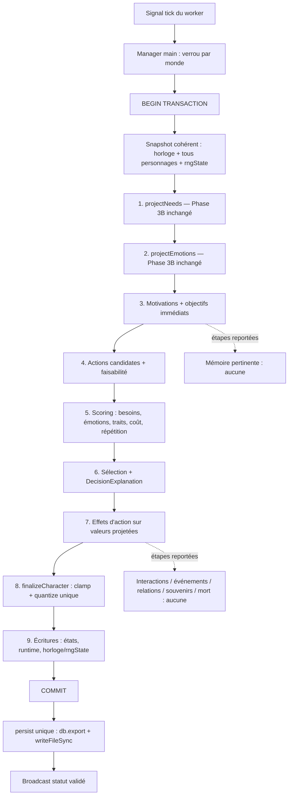
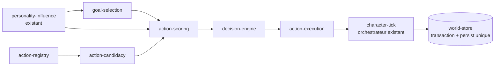

# Système de décisions autonomes — conception Phase 3C

> **Statut : proposition architecturale. Aucune décision autonome n'est implémentée
> dans cette tranche.** Le tick existant applique uniquement l'évolution passive des
> besoins et des émotions (Phase 3B). Cette tranche est **strictement documentaire** :
> aucun code applicatif, schéma SQLite, migration, IPC, renderer ni appel LLM modifié.
>
> Source de vérité de l'existant : `src/shared/character.ts`, `src/shared/simulation.ts`,
> `src/shared/simulation-rules.ts`, `src/main/services/character-tick.service.ts`,
> `src/main/services/world-store.service.ts`, `src/main/services/simulation-manager.service.ts`,
> `docs/CHARACTER_TICK_RULES.md`.

## 1. Audit obligatoire de l'existant (vérifié)

### 1.1 Git et contexte de tranche

| Élément | État au démarrage |
|---|---|
| Branche | `main` |
| HEAD | `1b391458ee5f8bb0da27ffd05950bdfd7935b5c7` |
| `origin/main` | identique à HEAD |
| Working tree | propre (aucune modification ni fichier non suivi) |
| Dernière tranche livrée | Phase 3B implémentée, validée (148/148 tests), commitée et poussée. |

### 1.2 Ce qui existe réellement dans le moteur

| Élément | État réel | Impact Phase 3C |
|---|---|---|
| `CharacterState` | `traits` (21), `emotions` (10), `needs` (8, 100 = satisfait), `goals` (1 principal + 2 secondaires, `{id,label,kind}`). | Seules ces données sont disponibles pour une décision. Aucun `action`, `location`, `item`, `resource`, `relationship`, `memory` ni `alive`. |
| `CharacterTickSnapshot` | `{characterId, traits, needs, emotions, goals}` readonly. | Doit être **étendu de façon additive** avec un runtime d'action ; aucun contexte externe ne doit être inventé. |
| `computeCharacterTick()` | Pure : `orderSnapshots` (tri lexicographique par id) → `projectNeeds` → `projectEmotions` → `finalizeCharacter`. | La Phase 3C s'insère **après** les projections et **avant** la quantification finale. |
| `projectNeeds()` / `projectEmotions()` | Snapshot de début de tick ; émotions lisent les besoins projetés comme entrée de calcul. | Les effets d'action s'ajoutent aux valeurs projetées, jamais au snapshot. |
| `finalizeCharacter()` | `clamp(0,100)` + `quantize(2)` half-even ; deltas recalculés après arrondi. | Une seule quantification par tick, y compris avec effets d'action. |
| `stepSimulation()` | `BEGIN` avant chargement → snapshot cohérent → calcul pur → écritures → `upsertClock` → `COMMIT` → **un seul** `persist(db)` → rollback total sur erreur. | Toute écriture Phase 3C (runtime, `rngState`) entre dans **la même transaction**. |
| `writeTickCharacterStates()` | Écrit `needs_json`/`emotions_json` + miroirs `current_*` + `updated_at`. `current_goals_json` n'est pas écrit. | L'ajout futur de `current_action_json` doit suivre le même chemin transactionnel. |
| `SimulationClock` | `tick`, `day`, `hour`, `status`, `speed`, `rngState` (uint32), `lastProcessedOrder` (0). | `rngState` pourra être consommé ; `lastProcessedOrder` reste 0 tant qu'aucun ordre intra-tick n'est requis. |
| `SeededRng` | mulberry32, `getState/setState`, `next/int/pick/chance`. | Départage éventuel, avec consommation tracée et rejeable. |
| Worker / Manager | Worker = planification/signaux uniquement ; main = seul écrivain SQLite, verrou par monde, anti double-tick, broadcast statut. | Les services de décision restent **côté main**, purs, sans Worker ni SQLite. |
| `TickDelta[]` | Calculés avec causes explicables, **non exposés** via IPC/UI. | Les explications de décision suivront la même politique : calculées, non massivement persistées. |
| `simulation_stopped` | `startSimulation()` refuse explicitement la reprise ; `stopSimulation()` est terminal ; recovery `running → paused` au redémarrage. | Aucun changement de comportement dans cette tranche (politique recommandée §12). |

### 1.3 Ce qui n'existe pas (à ne pas supposer)

Aucun environnement, lieu, objet, ressource partagée, inventaire, relation, événement,
souvenir, mort, dialogue, appel OpenRouter, table d'actions ni champ d'action n'existe.
Aucun `DecisionExplanation` n'est produit. **Toute conception qui utiliserait ces
notions comme si elles étaient disponibles est invalide.**

### 1.4 Divergences documentaires relevées

| Document | Divergence | Traitement |
|---|---|---|
| `docs/CHARACTER_TICK_RULES.md` §4.1 | Indique un tri par `localeCompare('en', {numeric:true})`. | Le code réel utilise une comparaison lexicographique directe (`<`/`>`) dans `orderSnapshots()`. La Phase 3C s'aligne sur le **code** (comparaison directe, indépendante de la locale). |
| `docs/SIMULATION_ENGINE.md` | Décrit un moteur 16 étapes **[Planifié]**, dont mémoire, interactions, événements, mort. | Ces étapes restent planifiées. La Phase 3C n'implémente que les étapes 4 (objectifs immédiats), 6–8 (actions, évaluation, décision) et 9 (exécution d'effets numériques), avec les étapes 5 et 10–15 **reportées**. |
| `docs/CHARACTER_TICK_RULES.md` §4.2 | Prévoit une consommation PRNG future documentée. | La Phase 3C définit précisément ce protocole (§9) ; aucun tirage n'a lieu tant qu'il n'y a pas d'ex æquo. |
| `HANDOFF.md` / `PROGRESS.md` | Mentionnent « Phase 3B prête à committer » et un hash antérieur. | Mis à jour dans cette tranche pour refléter HEAD `1b39145` et la Phase 3C documentaire. |
| `src/shared/simulation-rules.ts` (commentaire) | `deficitThreshold` y est commenté 80 alors que la valeur par défaut exécutée est 60. | La conception utilise la valeur réelle 60 ; correction du commentaire reportée en tranche dédiée. |

## 2. Périmètre de la Phase 3C

### Inclus (conception)
- Priorisation des besoins et urgences émotionnelles (voir `GOAL_SELECTION_SYSTEM.md`).
- Objectifs immédiats et motivations concurrentes.
- Actions candidates, faisabilité, scoring, personnalité, anti-répétition.
- Effets attendus, sélection finale, explication.
- Actions longues sur plusieurs ticks, interruption, échec, adaptation sans action possible.
- Équité multi-personnages, snapshot cohérent, déterminisme, transactions.
- Politique recommandée pour `simulation_stopped` (sans changement de comportement).
- Scénarios de tests futurs et critères de détection des pathologies.

### Exclus (reportés, non implémentés et non simulés)
- Relations, événements, souvenirs, mort/deuil, dialogues, LLM/OpenRouter.
- Environnement, lieux, objets, ressources, inventaire, compétences.
- Modification du schéma SQLite, du worker, des IPC, du preload ou du renderer.
- Écriture de `current_goals_json` par le moteur.

## 3. Vue d'ensemble du cycle



Ordre définitif : les décisions sont prises **après** l'évolution passive (besoins/émotions)
et **avant** la quantification finale. Raison : les effets d'action doivent s'intégrer au
même calcul, sans deuxième arrondi et sans état intermédiaire persisté.

## 4. Snapshot et équité multi-personnages

### 4.1 Snapshot cohérent

```ts
export interface AutonomousDecisionSnapshot extends CharacterTickSnapshot {
  /** Nouveauté proposée : runtime de l'action, valeur par défaut si absent. */
  actionRuntime?: CharacterActionRuntime;
  /** Deltas passifs calculés au même tick, nécessaires aux urgences de tendance. */
  passiveNeedDeltas: Readonly<Record<NeedKey, number>>;
  /** Déduit de `CharacterTickInput.characters.length > 1`, jamais inventé. */
  otherCharacterExists: boolean;
}
```

- Le snapshot est chargé **une fois**, dans la transaction, avant tout calcul.
- Aucune décision d'un personnage ne modifie le snapshot d'un autre.
- Les effets sont **appliqués différément**, après que toutes les décisions ont été prises.
- `rngState` est unique par monde : les tirages sont séquencés dans l'ordre des
  `characterId` triés lexicographiquement (§9).

### 4.2 Équité — règles définitives

| Risque | Règle retenue |
|---|---|
| Avantage lié à l'ordre du tableau d'entrée | `orderSnapshots()` trie déjà par `characterId` (comparaison directe) ; la Phase 3C conserve ce tri. |
| Biais d'ordre dans les motivations | Tri par urgence décroissante puis clé lexicographique croissante (jamais `Object.keys()` direct pour le départage). |
| Compétition pour une ressource | **Aucune ressource partagée n'existe** : aucune compétition en Phase 3C. Les conflits futurs seront arbitrés par un service central et non par « premier arrivé » [Reporté]. |
| Effet d'une action sur autrui | Interdit en Phase 3C : une action n'écrit que l'état de son exécutant. |
| PRNG consommé différemment selon l'ordre | Un seul tirage maximum par personnage, séquencé par id trié ; `rngDraws` tracé dans l'explication. |
| Écritures concurrentes | Worker sans SQLite ; main seul écrivain, verrou par monde, anti double-tick existants conservés. |

Test d'équité : deux exécutions avec la liste des personnages inversée produisent les
mêmes états, les mêmes décisions et le même `rngState` final.

## 5. Priorisation des motivations

La priorisation est entièrement définie dans `docs/GOAL_SELECTION_SYSTEM.md` :
- urgences des besoins depuis les **besoins projetés** et le delta passif ;
- urgences émotionnelles depuis les émotions du snapshot ;
- signal circadien depuis `hour` ;
- objectifs immédiats = motivations dominantes, `minimumMotivationUrgency` et limite
  configurables ;
- **`CharacterGoal.label` n'est pas interprété** (texte libre, LLM interdit).

Résumé des entrées d'une motivation :

```text
Motivation = { id, source: 'need'|'emotion'|'circadian', refKey, urgency ∈ [0,1],
               direction: 'increase'|'decrease', reason }
```

Aucune motivation n'est une action : elle n'a pas d'effet direct. Elle ne fait que
pondérer le score des actions candidates.

## 6. Actions candidates et faisabilité

Le catalogue est défini dans `docs/ACTION_SYSTEM.md`. En résumé :

| Catégorie | Actions Tier A (réalisables) | Actions Tier B (reportées) |
|---|---|---|
| Subsistance | `eat`, `drink` | — |
| Repos | `sleep`, `rest` | — |
| Hygiène | — | `wash` |
| Loisirs | `entertain_self` | `explore`, `practice_activity` |
| Social | `be_alone`, `seek_company` (si ≥ 2 personnages) | — |
| Repli | `idle` | — |

Faisabilité (décisions définitives) :
1. une action Tier B est **toujours** exclue (`environment_unavailable`) ;
2. une précondition échouée exclut l'action, elle ne la pénalise pas ;
3. une action active (longue) bloque les autres sauf interruption validée ;
4. un cooldown actif exclut l'action ;
5. `idle` est toujours faisable, même si toutes les autres actions sont exclues.

Si aucune action sauf `idle` n'est faisable, la décision est `idle` avec
`selectionRule = 'forced_idle'` et une raison explicite. Aucun personnage ne reste sans
décision, et aucun « no-op silencieux » n'est confondu avec une action réelle.

## 7. Scoring

### 7.1 Formule proposée

```text
score(action) = quantize( clamp( rawScore, -5, 5 ), DECISION_SCORE_PRECISION )

rawScore =
    NEED_WEIGHT      * Σ_b ( min(satisfies_b * timingFactor, 100 - need_b) / 100 ) * urgency_b
  + EMOTION_WEIGHT   * Σ_e ( alignement_e * emotionalEffect_e / 100 ) * emotionalUrgency_e
  + TRAIT_WEIGHT     * ( traitMultiplier(traits, affinity) - 1 )
  + CIRCADIAN_WEIGHT * nightBonus(action)
  - COST_WEIGHT      * Σ_b ( costs_b / 100 ) * urgency_b
  - REPETITION_WEIGHT * repetitionPenalty(action)
  - DURATION_WEIGHT  * ( durationTicks - 1 ) / MAX_ACTION_DURATION_TICKS
```

- `timingFactor` = nombre de ticks d'application (`durationTicks` pour `per_tick`, 1 pour
  `on_completion`) ; les gains nominaux du catalogue sont **par tick** pour `per_tick`.
- `satisfies_b` et `costs_b` sont les valeurs nominales de l'action ; `min(..., 100 - need_b)`
  évite de récompenser un gain qui serait de toute façon borné par le clamp.
- `emotionalUrgency_e` suit la direction de l'émotion (voir `GOAL_SELECTION_SYSTEM.md` §4).
- `alignement_e = -1` pour les émotions à diminuer (`stress`, `anxiété`, …) et `+1` pour
  celles à augmenter (`bonheur`, `confiance`, …) : réduire le stress doit **augmenter** le score.
- `traitMultiplier()` est le helper existant, borné `[0.5, 1.5]` ; le terme est donc
  borné `[-0.125, +0.125]` avec `TRAIT_WEIGHT = 0.25`.
- `nightBonus(action)` = 1 pour `sleep` entre 22 h et 7 h, 0 sinon (signal circadien).
- `repetitionPenalty = min(1, occurrences dans recentActionIds / ACTION_HISTORY_SIZE)`.
- `DECISION_SCORE_PRECISION` [proposé] = 3 décimales : évite les ex æquo dus au flottant
  tout en restant lisible dans les explications.
- Poids [hypothèses configurables] : `NEED_WEIGHT = 1.0`, `EMOTION_WEIGHT = 10`,
  `TRAIT_WEIGHT = 0.25`, `CIRCADIAN_WEIGHT = 0.10`, `COST_WEIGHT = 0.8`,
  `REPETITION_WEIGHT = 0.30`, `DURATION_WEIGHT = 0.05`.
- **Calibration révisée à l'implémentation (tranche 2)** : la valeur documentée initialement
  (`EMOTION_WEIGHT = 0.35`) rendait un effet émotionnel nominal de −1 (soit −0.01 après
  division par 100) négligeable devant un gain de besoin. `10` transforme ce même effet en
  +0.10 de score après alignement, ce qui permet à un personnage anxieux de choisir une
  action calmante. La valeur reste `DecisionParameters.emotionWeight` et peut être recalibrée
  sans toucher au code ; tout changement doit être accompagné des tests de scénario.

### 7.2 Propriétés testables

- Une action qui satisfait un besoin urgent avec un grand gain bat une action qui
  satisfait un besoin peu urgent, à personnalité égale.
- Une action coûteuse sur un besoin critique est pénalisée (ex. `be_alone` quand
  `socialization ≈ 0`).
- Une action qui réduit le stress quand le stress est élevé bat une action qui l'augmente,
  à personnalité égale.
- Deux personnages identiques sauf `sociability`/`independence` peuvent départager
  `seek_company` et `be_alone` différemment.
- `idle` a un score exactement 0 et n'est jamais pénalisé par la répétition.
- Le score reste dans `[-5, 5]` et est déterministe pour une entrée donnée.
- Le score est calculé depuis les valeurs **projetées**, jamais depuis l'état déjà modifié
  par une autre action du même tick.

### 7.3 Ce qui n'entre pas dans le score

- `CharacterGoal.label` (aucune interprétation textuelle).
- Relations, souvenirs, événements, lieux, objets (aucune donnée correspondante).
- Résultat d'un appel LLM (interdit).
- `Date.now()` (horodatage réel uniquement, hors calcul).

## 8. Sélection finale

```text
candidats     = actions faisables, avec score quantifié
si action active et non interrompue : conserver l'action active (aucun re-scoring)
sinon :
  meilleur   = max par score
  ex æquo    = départage par PRNG ou par identifiant selon decisionPolicy
  si aucun candidat sauf idle : idle (forced_idle)
```

Décisions définitives :
- La sélection est **totale** : chaque personnage produit exactement une décision par tick.
- Le départage par identifiant lexicographique est la valeur par défaut des tests de rejeu.
- Le départage par PRNG est activable et définit le protocole de consommation (§9).
- Une action interrompue n'est pas automatiquement reprise ; elle repasse par la sélection.

## 9. PRNG : protocole de consommation

`SimulationParametersV1` est étendu de façon proposée par :

```ts
interface DecisionParameters {
  tieBreak: 'id' | 'rng';       // défaut documenté : 'rng'
  decisionScorePrecision: 3;
  /** Un seul tirage maximum par personnage et par tick. */
  maxRngDrawsPerCharacterTick: 1;
}
```

Protocole définitif si `tieBreak = 'rng'` :
1. les personnages sont traités dans l'ordre des `characterId` triés ;
2. un tirage `rng.next()` est consommé **uniquement si** au moins deux candidats ont le
   même score quantifié à 3 décimales ;
3. le tirage choisit un index dans la liste des ex æquo triés par identifiant ;
4. **au plus un tirage par personnage et par tick**, quel que soit le nombre d'ex æquo ;
5. `rngState` est écrit après le dernier tirage du tick, dans la même transaction ;
6. `rngStateBefore`, `rngStateAfter` et `rngDraws` sont enregistrés dans
   `DecisionExplanation` ;
7. si `tieBreak = 'id'`, aucun tirage n'a lieu et `rngState` reste inchangé.

Justification : cela satisfait l'architecture cible « PRNG.seedé + explication »
(AGENTS.md §8) sans introduire d'aléa dans les conséquences, tout en restant rejeable
après redémarrage. La consommation est **conditionnelle**, donc les simulations sans
ex æquo conservent un `rngState` identique à la Phase 3B.

## 10. Explicabilité

```ts
export interface DecisionExplanation {
  worldId: string;
  characterId: string;
  tick: number;
  day: number;
  hour: number;
  /** Source de vérité des règles, pour rejeu. */
  ruleId: 'decision.v1';
  motivations: ImmediateGoal[];
  candidateScores: Array<{
    actionId: ActionId;
    score: number;
    feasible: boolean;
    rejections: string[];
    components: {
      need: number; emotion: number; trait: number; circadian: number;
      cost: number; repetition: number; duration: number;
    };
  }>;
  selectedActionId: ActionId;
  selectionRule: 'score_tiebreak_rng' | 'score_tiebreak_id' | 'forced_idle'
                | 'continue_active' | 'interruption';
  /** Actions exclues avec la raison de faisabilité. */
  rejected: Array<{ actionId: ActionId; reasons: string[] }>;
  expectedEffects: { needs: Partial<Record<NeedKey, number>>; emotions: Partial<Record<EmotionKey, number>> };
  rngStateBefore: number;
  rngStateAfter: number;
  rngDraws: 0 | 1;
}
```

- `DecisionExplanation` est **calculée et retournée** par le moteur, comme `TickDelta[]`.
- [Décision] non persistée intégralement par défaut (volume) : un résumé compact
  (`lastDecision`) est conservé dans le runtime d'action ; l'explication complète est
  **reconstructible par rejeu** depuis le snapshot, les paramètres et `rngState`.
- [Reporté] table dédiée aux explications si l'UI d'historique en a besoin.
- Aucune explication n'influence le monde : c'est un artefact d'audit, pas une mémoire.

## 11. Adaptation et stabilité

| Situation | Comportement définitif |
|---|---|
| Aucune action faisable | `idle`, `selectionRule = 'forced_idle'`, raison explicite. |
| Action longue en cours, aucune urgence critique | Continuer l'action, appliquer les effets `per_tick`, ne pas re-scorer. |
| Urgence critique pendant une action longue | Interrompre **uniquement si** les 4 conditions de `ACTION_SYSTEM.md` §8 sont réunies. |
| Précondition devenue fausse pendant l'action (ex. besoin remonté) | Terminer l'action en cours si elle est déjà entamée ; ne pas l'annuler rétroactivement. [Hypothèse] |
| Échec d'action | Conserver les effets déjà appliqués (`keep_partial`), abandonner le futur, tracer la raison. |
| Runtime absent (base antérieure) | Valeur par défaut `CharacterActionRuntime` vide, migration additive future. |
| Valeur runtime corrompue | Erreur technique de tick → rollback complet (pas une décision métier). |

Anti-churn : cooldowns, historique glissant, pénalité de répétition et absence de
re-décision pendant une action longue. Ces mécanismes sont **cumulatifs** : aucun ne suffit
isolément à garantir la stabilité.

## 12. Politique recommandée pour `simulation_stopped`

### 12.1 Comportement actuel (conservé, non modifié)

- `stopSimulation()` met `worlds.status = 'simulation_stopped'` et
  `simulation_clock.status = 'stopped'`.
- `startSimulation()` refuse explicitement un monde arrêté (« pas de redémarrage
  implicite »).
- `recoverSimulationClocksAfterRestart()` ne touche que les horloges `running` (→ `paused`).
- Les données restent conservées et consultables.

### 12.2 Options étudiées

| Option | Avantage | Risque |
|---|---|---|
| **A — arrêt terminal strict** | Simple, aucune ambiguïté sur l'état arrêté. | Perd la possibilité de continuer une histoire ; frustre l'utilisateur. |
| **B — reprise explicite sur place** | Reprend exactement là où l'arrêt a eu lieu. | Écrase un état volontairement « clos » ; l'historique de l'arrêt devient ambigu ; risque si l'utilisateur croyait l'action définitive. |
| **C — nouvelle branche depuis l'état arrêté** | Préserve l'archive intacte et permet de continuer ; sémantique claire de « suite alternée ». | Nouvelle sauvegarde à gérer dans l'UI. |

### 12.3 Recommandation : **option C**

**Recommandation documentaire, aucun changement de comportement dans cette tranche.**

- La commande future `forkFromStopped(worldId)` créerait un **nouveau monde** :
  - nouvel `id` et nouveau nom dérivé (ex. `« Nom » — suite`) ;
  - copie des `characters` courants (`current_*` → `initial_*` et `current_*` de la branche) ;
  - copie de `tick`, `day`, `hour` et **`rngState`** (continuité exacte de la séquence) ;
  - nouveau statut `simulation_paused` : **aucune reprise automatique** ;
  - le monde source reste `simulation_stopped`, inchangé et auditable.
- confirmation utilisateur explicite obligatoire (libellé clair : « créer une suite »),
  jamais un simple clic sur « Démarrer ».
- [Reporté] IPC, preload, UI, service et tests dédiés. À valider par le produit avant
  toute implémentation.

Décision : ne pas transformer silencieusement `stop` en `pause`, et ne pas autoriser
`start` sur `simulation_stopped` dans l'attente de cette validation.

### 12.4 Recette technique précise de `forkFromStopped` [Reporté]

Commande future du processus principal, **jamais** un réflexe de `startSimulation` :
`forkFromStopped(worldId, name?)`. Elle est refusée si le monde source n'est pas
`simulation_stopped`, si son horloge est absente/corrompue, si un tick est en cours
(verrou du `SimulationManager`) ou si un runtime de personnage est corrompu. Aucune
erreur de données n'est réparée silencieusement : la transaction est annulée.

1. **Nouveau monde, pas une réactivation.** Insertion d'une ligne `worlds` avec un
   nouveau `id = randomUUID()`, un nom dérivé `"<nom source> — suite"` (tronqué à 80
   caractères, suffixe compris), `generation_mode` identique, `character_count` copié,
   `created_at`/`updated_at = now`, `last_opened_at = NULL` et
   `status = 'simulation_paused'`. La ligne source n'est **pas** mise à jour : ni statut,
   ni `updated_at`, ni `last_opened_at`. Elle reste `simulation_stopped` et auditable.
2. **Copie cohérente des personnages.** Pour chaque ligne source triée par `id`, insertion
   d'une ligne distincte avec `id = "<newWorldId>:<sourceId>"` (préfixe identique pour
   tous : l'ordre lexicographique relatif, donc l'ordre de départage, est préservé),
   `world_id = newWorldId`, identité et biographie copiées, `template_id = NULL`
   (aucun lien mutable avec la bibliothèque), `created_at = now`, `updated_at = now`.
   Les six colonnes `initial_*_json` reçoivent les `current_*_json` de la source : la
   branche démarre exactement de l'état final observé, pas des paramètres d'origine.
   Les six `current_*_json` reçoivent les mêmes valeurs. `current_goals_json` est copié
   **octet pour octet** et reste non interprété. `current_action_json` est copié en
   profondeur (runtime complet : `active`, `recentActionIds`, `cooldowns`,
   `lastDecision`, `interruptedCount`) afin de préserver l'historique court pertinent ;
   aucun nouvel événement, souvenir ou relation n'est fabriqué.
3. **Nouvelle horloge, contexte continu.** Insertion d'une ligne `simulation_clock`
   unique pour `newWorldId` avec `tick`, `day`, `hour`, `speed` et **`rngState`** copiés
   de la source (continuité exacte de la séquence mulberry32), `status = 'paused'`,
   `last_processed_order = 0`, `created_at`/`updated_at = now`. Le `seed` du monde est
   copié ; il ne ressème pas le PRNG.
4. **Indépendance totale.** Aucune ligne n'est partagée entre les deux mondes : chaque
   branche possède ses personnages, son runtime, son horloge et son `rngState`. Une
   écriture, une action ou un arrêt dans la suite ne modifie jamais le monde arrêté,
   et inversement. Les modèles de la bibliothèque restent des références en lecture
   seule depuis la branche (`template_id = NULL`).
5. **Transaction et persistance.** `BEGIN` avant la lecture cohérente de la source,
   validations, toutes les insertions, `COMMIT`, puis un seul `persist(db)`. Toute
   erreur déclenche un `ROLLBACK` complet : aucun monde partiel, aucun personnage
   orphelin, aucun fichier écrit.
6. **Interface explicite.** Aucun bouton « Démarrer » ne peut appeler cette commande.
   L'UI future doit présenter une action distincte « Créer une suite », avec confirmation
   indiquant que le monde arrêté est conservé et qu'une nouvelle sauvegarde est créée.
   La suite s'ouvre en pause ; le démarrage est une seconde action volontaire.
7. **Exclusions.** Pas d'héritage de relations, lieux, objets, ressources, événements,
   souvenirs, morts ni dialogues (aucune donnée de ce type n'existe). Pas de
   réinterprétation des objectifs persistants. Pas de remise à zéro des compteurs
   d'échec ou d'interruption.

[Reporté] service, hook IPC/preload, bouton, tests dédiés et validation produit.
Cette recette n'est **pas implémentée** dans la tranche Phase 3C en cours.

## 13. Compatibilité services existants

### 13.1 Découpe retenue (sept services purs, implémentés en tranche 2)

L'utilisateur proposait `decision-engine`, `action-registry`, `action-execution`,
`goal-selection`. La découpe retenue ajoute **`action-candidacy`** et **`action-scoring`**
pour isoler deux responsabilités distinctes et testables séparément : la *faisabilité*
(qui peut être testée sans aucun poids de scoring) et l'*évaluation* (qui peut être testée
sans aucune précondition).

| Service proposé | Responsabilité | Entrée | Sortie | Dépendance |
|---|---|---|---|---|
| `action-registry.service.ts` | Catalogue statique versionné, validation, lookup. | identifiant | `ActionDefinition` | helpers de validation purs |
| `goal-selection.service.ts` | Motivations et objectifs immédiats. | besoins projetés, émotions, `hour`, params | `GoalSelectionResult` | `personality-influence` (pressions) |
| `action-candidacy.service.ts` | Candidats et évaluation des préconditions. | snapshot étendu, registre, runtime | `ActionCandidate[]` | aucun scoring |
| `action-scoring.service.ts` | Scores, traits, coût, répétition, durée. | candidats, motivations, params | `ScoredCandidate[]` | `personality-influence.traitMultiplier` |
| `decision-engine.service.ts` | Sélection finale, PRNG, `DecisionExplanation`. | `scored`, `interruptionScored`, `SeededRng`, params | `DecisionResult` | `SeededRng` (injection) |
| `action-runtime.service.ts` | Parse/sérialisation et transitions du runtime. | JSON ou runtime, tick, durée, cooldown | `CharacterActionRuntime` | aucun |
| `action-execution.service.ts` | Effets sur valeurs projetées, deltas, règles d'échec. | définition, valeurs projetées, traits, runtime actif | `ActionExecutionResult` (déjà quantifié) | `finalizeValue` une seule fois |

`character-tick.service.ts` reste **l'orchestrateur unique** : il appellera ces services
dans l'ordre du §3 et retournera un résultat enrichi (intégration prévue en tranche 3).
Aucun de ces services n'importe Electron, SQLite, le renderer ou le réseau.

Deux jeux de candidats sont nécessaires : `scored` reflète l'état courant (où
`no_active_action` rend les alternatives infaisables), tandis que `interruptionScored`
est calculé avec `active = null` et sert **uniquement** à vérifier la quatrième condition
d'interruption. Sans ce second jeu, aucune interruption ne pourrait jamais avoir lieu.



### 13.2 Extension additive des contrats existants

```ts
export interface CharacterTickInput {
  // Champs Phase 3B inchangés :
  worldId: string; tick: number; day: number; hour: number;
  seed: number; rngState: number; characters: readonly CharacterTickSnapshot[];
  params: SimulationParametersV1;
  // Ajouts implémentés (optionnels pour compatibilité) :
  decisionParams?: DecisionParameters;
  actionRuntimeByCharacter?: Readonly<Record<string, CharacterActionRuntime>>;
}

export interface CharacterTickResult {
  // Champs Phase 3B inchangés :
  worldId: string; tick: number; rngState: number; characterStates: Array<...>;
  deltas: TickDelta[]; warnings: string[];
  // Ajouts implémentés (tableaux vides jusqu'à l'intégration du tick) :
  decisions: DecisionExplanation[];
  actionDeltas: ActionEffectDelta[];
  actionRuntimeStates: Array<{ characterId: string; runtime: CharacterActionRuntime }>;
}
```

> **Changement de contrat à documenter lors de l'implémentation** : `rngState` n'est plus
> garanti identique à l'entrée (il peut être consommé par le départage). Il reste identique
> quand aucun tirage n'a lieu.

### 13.3 Persistance

- Aucune nouvelle table requise pour le minimum fonctionnel.
- Une colonne additive future `characters.current_action_json` (TEXT NOT NULL DEFAULT
  `'{"version":1,"active":null,"recentActionIds":[],"cooldowns":{},"lastDecision":null}'`
  après backfill) contient le runtime.
- `current_goals_json` reste inchangé.
- `simulation_clock.rng_state` est écrit avec le nouvel état, dans la même transaction.
- `last_processed_order` reste 0.
- Un seul `persist(db)` par tick, comme en Phase 3B.
- Le hook `_setTickFailureForTests()` doit être étendu pour vérifier le rollback des
  effets d'action et du runtime, pas seulement de l'horloge.

## 14. Déterminisme et indépendance

| Garantie | Mécanisme |
|---|---|
| Même entrée → même sortie | Snapshot, tri lexicographique, scores quantifiés, aucune date réelle dans le calcul. |
| Aucun `Math.random()` | `SeededRng` uniquement, consommation conditionnelle tracée. |
| Aucun `Date.now()` dans les règles | Horloge logique `tick/day/hour`; horodatages uniquement pour `updated_at`. |
| Indépendance d'Electron/renderer | Services purs, aucun import `electron`, `sql.js` ou React. |
| Testable Vitest en Node | Aucune dépendance à une fenêtre, un IPC ou un WASM. |
| Reproductible après redémarrage | `current_*_json` + `current_action_json` + `rngState` persistés ; rejeu depuis l'état sauvegardé. |
| Pas de dépendance LLM | Aucun appel réseau, aucune interprétation de texte libre. |

## 15. Scénarios de tests futurs et critères de détection

### 15.1 Scénarios obligatoires

| # | Scénario | Attendu |
|---:|---|---|
| 1 | Rejeu identique 24 / 72 / 168 / 720 / 3000 ticks, 2 personnages | états, décisions et `rngState` identiques. |
| 2 | Liste des personnages inversée | mêmes décisions, même `rngState` final. |
| 3 | Redémarrage après tick N puis reprise | décision au tick N+1 identique à une exécution sans redémarrage. |
| 4 | Tous besoins à 100 | `idle` choisi ; aucune action de subsistance. |
| 5 | `thirst = 0`, autres besoins corrects | `drink` choisi sous 2 ticks, sauf coût bloquant documenté. |
| 6 | `socialization = 0`, 1 seul personnage | `seek_company` exclu, `be_alone` pénalisé, `entertain_self` envisageable. |
| 7 | Deux personnages, `sociability` 90 vs 20 | préférence différente pour `seek_company` / `be_alone`. |
| 8 | `sleep` démarré au tick T | aucun re-scoring pendant 8 ticks, effets `per_tick` appliqués, besoins/émotions continuaient d'évoluer. |
| 9 | Urgence critique au tick T+2 pendant `sleep` | interruption uniquement si les 4 conditions sont réunies. |
| 10 | Action Tier B (`wash`) avec hygiène à 0 | jamais sélectionnée ; `rejected` contient `environment_unavailable`. |
| 11 | Panne injectée avant `upsertClock` | rollback de états, runtime, effets et `rngState` ; aucun `persist`. |
| 12 | 1000 ticks avec profils variés | `current_goals_json` inchangé octet pour octet. |

### 15.2 Critères de détection des pathologies

| Pathologie | Critère proposé (hypothèse à calibrer) | Mécanisme de détection |
|---|---|---|
| **Boucle d'actions** | Même action > 6 fois sur 10 ticks sans déficit correspondant. | Fenêtre glissante sur `recentActionIds` + urgence de l'action au moment du choix. |
| **Comportement répétitif** | Séquence de longueur 2 ou 3 répétée ≥ 4 fois sur 30 ticks. | Comptage de motifs cycles dans l'historique. |
| **Changement permanent d'objectif** | Toute différence de `current_goals_json` entre le début et la fin d'une simulation. | Comparaison directe avant/après (doit être strictement nulle). |
| **Besoins négligés** | Un besoin reste < 20 pendant > 8 ticks alors qu'une action Tier A réalisable l'améliore et qu'aucun coût critique ne l'empêche. | Surveillance des urgences et des candidats rejetés. |
| **Décision contradictoire** | Une action choisie diminue un besoin à < 15 alors qu'une alternative réalisable l'augmente sans coût critique. | Comparaison `costs` / `satisfies` et urgence au moment du choix. |
| **Personnage inactif** | `idle` choisi > 5 ticks consécutifs alors qu'au moins un candidat non-`idle` est faisable et a un score > 0. | Comptage de `selectionRule = 'forced_idle'` vs `idle` normal. |
| **Churn d'action** | > 3 changements d'action sur 10 ticks sans interruption critique. | Comptage des transitions `Active → Interrupted/Completed`. |
| **Saturation artificielle** | Besoin/émotion bloqué à 0 ou 100 sans cause active, déjà couvert par les tests Phase 3B. | Tests longs existants + effets d'action bornés par la marge. |

Ces seuils sont des **hypothèses** : ils doivent être calibrés par simulation longue avant
d'être transformés en assertions strictes.

## 16. Décisions, hypothèses, reporté

### Décisions définitives
- Conception documentaire terminée et validée ; implémentation progressive depuis la tranche 1.
- Cycle : besoins → émotions → motivations → actions → décision → effets → quantification unique.
- Snapshot cohérent, application différée, tri lexicographique, pas de biais d'ordre.
- Services purs côté main, sept responsabilités séparées, orchestrateur existant conservé.
- Aucune action ne modifie un autre personnage ; aucune ressource partagée n'existe.
- `current_goals_json` non écrit ; `label` non interprété.
- Effets bornés par la marge, une seule quantification par tick.
- Actions longues sans re-décision ; interruption conditionnée par 4 critères cumulatifs.
- `idle` explicite si aucune action réalisable.
- PRNG consommé au plus une fois par personnage et par tick, uniquement en cas d'ex æquo.
- `simulation_stopped` inchangé ; recommandation = nouvelle branche explicite.

### Hypothèses configurables (à calibrer)
- Tous les poids de scoring, seuils d'urgence, criticités, durées, cooldowns et effets
  nominaux (voir les deux documents complémentaires).
- Seuils de détection des pathologies (§15.2).
- Précision du score à 3 décimales, borne `[-5, 5]`.

### État d'implémentation (tranche 2)
- **Livrés** : contrats partagés et catalogue (tranche 1), puis les sept services purs
  `action-registry`, `goal-selection`, `action-candidacy`, `action-scoring`,
  `decision-engine`, `action-runtime` et `action-execution`, avec 51 tests unitaires dédiés.
- **Non livré** : aucun de ces services n'est encore appelé par `character-tick.service.ts`.
  Le tick retourne donc trois tableaux vides et le comportement Phase 3B reste inchangé.
- Aucune colonne SQLite, migration, IPC, preload, UI, worker ni appel LLM modifié.
- `simulation_stopped` reste terminal ; `forkFromStopped` reste une recette documentée.

### Reporté (à ne pas implémenter sans tranche dédiée)
- Intégration des services au tick, colonne `current_action_json`, migration additive et
  table d'historique des actions.
- Hystérésis persistée des objectifs immédiats ; `CharacterGoalV2` structuré.
- Lieux, objets, ressources, compétences → activation des actions Tier B.
- Relations, événements, souvenirs, mort, dialogues, OpenRouter.
- Nouvelle branche depuis `simulation_stopped` (`forkFromStopped`).
- Persistance intégrale des `DecisionExplanation`.

## 17. Liens

- `docs/ACTION_SYSTEM.md` — catalogue, préconditions, effets, machine à états.
- `docs/GOAL_SELECTION_SYSTEM.md` — urgences, motivations, objectifs immédiats.
- `docs/CHARACTER_TICK_RULES.md` — protocole Phase 3B que la Phase 3C étend.
- `docs/SIMULATION_TIME_AND_ENGINE.md` — horloge, PRNG, worker/main.
- `docs/EVENT_AND_MEMORY_SYSTEM.md` — conséquences non numériques reportées.
- `docs/CHARACTER_STATE_ARCHITECTURE.md` — `initialState` / `currentState`.
- `docs/SIMULATION_ENGINE.md` — cycle cible 16 étapes (statut [Planifié]).
