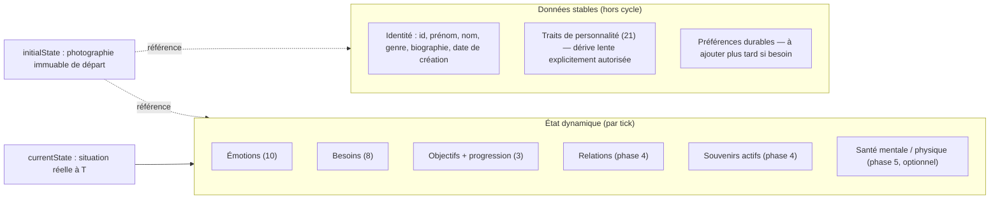

# Architecture de l'état des personnages — conception Phase 2

> **Statut : proposition architecturale. Aucun code, aucun schéma, aucun moteur implémenté
> dans cette tranche.** Les sections marquées **[Planifié]** décrivent des cibles, pas
> l'existant. Source de vérité de l'existant : `src/shared/character.ts`,
> `src/main/services/world-store.service.ts`, `docs/DATABASE.md`.

## 1. Audit de l'existant (vérifié dans le code)

### 1.1 Ce qui existe réellement

| Élément | État réel |
|---|---|
| Types partagés | `CharacterInstance` (= alias `Character`) : identité (`firstName`, `lastName`, `age`, `gender`, `biography`), `worldId`, `templateId: string \| null`, `initialState`, `currentState`, `createdAt`, `updatedAt`. `CharacterState = { traits, emotions, needs, goals }`. |
| Échelles | 21 traits, 10 émotions, 8 besoins, tous des **entiers 0-100** ; besoins : 100 = satisfait. Âge 18-65. Objectifs : exactement 1 principal + 2 secondaires, `{ id, label, kind }`. |
| Stockage | Une seule base `data/saves/worlds.sqlite`. Table `characters` avec colonnes d'identité, 4 colonnes legacy `*_json`, 4 colonnes `initial_*_json`, 4 colonnes `current_*_json`, FK `world_id → worlds(id) ON DELETE CASCADE`. `template_id` sans FK. |
| lecture | `rowToCharacter()` lit `current_*_json` avec repli sur `*_json`, et `initial_*_json` avec le même repli. |
| écriture | `insertCharacters()` écrit les 12 colonnes JSON (legacy + initial + current) ; `updateCharacterInstance()` réécrit les 12 colonnes et **réaligne initial = current** (préparation uniquement). |
| Migration | `ensureSchema()` : `CREATE TABLE IF NOT EXISTS`, `ALTER TABLE ADD COLUMN`, backfill `COALESCE(...)`, puis création des index. Déjà testée sur base legacy. |
| Protection | `assertWorldPreparation(db, worldId)` refuse création/instanciation/modification/suppression si `worlds.status = 'simulation_started'` ; contrôle côté main. |
| Déterminisme | `SeededRng` (mulberry32) sans `Math.random()` ; `worlds.seed` sert à la génération initiale, `generateCharactersForWorld()` dérive une sous-seed par index. |
| Validation | `validateCharacterDraft()` côté main : types, bornes, clés exactes, objectifs, chaînes. |
| UI | Formulaires 6 étapes, bibliothèque, fiches détaillées, cartes monde ; aucune écriture de `currentState` hormis l'édition manuelle en préparation. |
| Tests | 88/88 (8 fichiers) couvrent CRUD, isolation, migration, verrouillage et UI. Aucun test de simulation (aucun moteur). |

### 1.2 Ce qui manque ou mérite une décision avant implémentation

1. **Aucune séparation formelle Stable / Dynamique** : `CharacterState` contient les 21 traits
   et les 3 objectifs avec leurs seules données d'identité (`label`, `kind`). Les traits sont
   aujourd'hui dans le même objet que les émotions et besoins, donc techniquement éditables
   comme eux. Un moteur naïf pourrait les faire évoluer à chaque cycle.
2. **Aucune progression d'objectif** : `CharacterGoal` n'a ni statut ni mesure d'avancement.
   Un objectif ne peut aujourd'hui être que modifié manuellement en préparation.
3. **Aucune sérialisation du PRNG** : `SeededRng.state` est privé, sans `getState()/setState()`.
   Un redémarrage ne peut pas reprendre la séquence exacte là où elle s'est arrêtée
   (voir `docs/SIMULATION_TIME_AND_ENGINE.md`).
4. **Pas de verrou physique de l'état initial** : l'immuabilité repose sur l'usage de
   `assertWorldPreparation` dans les handlers existants. Le champ est nullable en base
   (rempli par backfill), et aucune contrainte n'empêche une écriture future dans
   `initial_*_json` après démarrage.
5. **Double miroir legacy/current** : 12 colonnes JSON stockent 8 objets logiques. Toute
   nouvelle écriture doit maintenir les deux miroirs cohérents, sinon lecture et écriture
   divergent (risque identifié dans `docs/HANDOFF.md`).
6. **Pas d'horodatage de l'état, ni de version de schéma d'état** : `updatedAt` est une date
   d'édition, pas un numéro de cycle ; une détection de conflit entre deux writers est
   impossible aujourd'hui.
7. **`age` est statique** : aucun mécanisme de vieillissement ; cohérent avec l'absence de
   temps simulé. À décider avant d'écrire des règles de mort/vieillesse.
8. **`src/main/simulation/` est vide** ; aucun worker, aucun tick, aucun événement, aucune
   relation, aucune mémoire, aucun appel LLM. Rien à réutiliser, tout est à concevoir.

### 1.3 Contraintes à respecter (non négociables)

- TypeScript strict, kebab-case, un fichier = une responsabilité, commentaires FR.
- Renderer sans Node/IPC direct ; tout passe par `src/preload/preload.ts` → `ipcMain.handle`
  → service main → SQLite. Aucune connexion SQLite exposée au renderer.
- `contextIsolation: true`, `nodeIntegration: false`, `sandbox: true`, `webSecurity: true`.
- Migrations **additives** et rétrocompatibles ; aucune suppression de colonne, aucun
  `ALTER` destructif ; tester sur une base au schéma précédent (leçon du bug de l'index
  `template_id`).
- Persistance fiable : `db.export()` + `writeFileSync` après mutation ; aucune perte après
  redémarrage.
- Aucune décision métier ne dépend du LLM ; le LLM n'enrichira que des dialogues (phase 6).
- Aucune modification de code/schéma dans cette tranche de conception.

## 2. Découpage conceptuel : Stable / Dynamique



### 2.1 Données stables

| Donnée | Responsabilité | Évolution autorisée |
|---|---|---|
| `id`, `worldId`, `templateId`, `createdAt` | Identité et provenance. **Jamais** modifiables après création. | Aucune. |
| `firstName`, `lastName` | Identité civile. | Édition **manuelle en préparation uniquement** ; aucun changement automatique. |
| `gender`, `biography` | Identité/récit de départ. | Idem. Un changement de biographie en cours de simulation devrait être un événement, pas une mutation silencieuse. |
| `age` | Âge initial. | Figé en Phase 2. Vieillissement **[Planifié, phase 5]** avec règle explicite liée au temps, pas un incrément automatique opiné ici. |
| `traits` (21) | Tempérament, base d'évaluation des actions. | **Stable par défaut**. Dérive lente possible **uniquement** via une règle documentée, rare, avec événement associé et bornes (voir §2.3). |
| Préférences durables | Goûts, aversions, valeurs. | **Pas encore dans le code**. Si ajouté : table séparée, pas dans `CharacterState`. |

### 2.2 Données dynamiques

| Donnée | Responsabilité | Fréquence envisagée (à valider, pas un choix final) |
|---|---|---|
| `emotions` (10) | Réaction courante, régulée par les traits et les événements. | Chaque tick ou sous-cycle ; décroissance vers une ligne de base dérivée des traits. |
| `needs` (8) | Pression qui motive les actions. | Chaque tick ; dérive négative puis satisfaction par action. |
| `goals` (3) | Direction et progression. | Statut/progression à chaque tick ; libellé **jamais** modifié par le moteur. |
| Relations | Liens asymétriques (voir `docs/RELATIONSHIP_SYSTEM.md`). | À chaque interaction, pas à chaque tick pour tous les couples. |
| Souvenirs | Trace subjective conservée par le personnage (voir `docs/EVENT_AND_MEMORY_SYSTEM.md`). | À la consolidation, pas à chaque tick. |
| Santé physique/mentale | Extension éventuelle (phase 5). | Décidée plus tard ; ne pas anticiper de colonnes maintenant. |

### 2.3 Règle explicite pour une dérive des traits (si retenue plus tard)

Aucune implémentation maintenant. Le contrat proposé :

- dérive **maximale** de ±1 point par `N` ticks (N à calibrer, jamais par tick) ;
- bornes 0-100, entiers, validation identique à `validateCharacterDraft()` ;
- uniquement pour un sous-ensemble explicite (ex. `resilience`, `distrust`), jamais
  `intelligence` ou `honesty` sans événement majeur documenté ;
- chaque changement produit un événement `trait_change` avec cause, avant/après et tick ;
- `initialState.traits` reste le référentiel : la dérive ne l'écrit jamais.

## 3. Responsabilité de `initialState` et `currentState`

### 3.1 Définition contractuelle

- **`initialState`** : photographie des paramètres de départ au moment de la création ou de
  la dernière édition en préparation. **Référence immuable dès que
  `worlds.status = 'simulation_started'`.** Sert de ligne de base pour la régulation
  émotionnelle, le calcul de dérive, les comparaisons et la reproductibilité.
- **`currentState`** : situation réelle du personnage au tick courant. C'est la **seule**
  source pour l'affichage « en cours », l'évaluation des actions et les conséquences.
- Au démarrage, `currentState` est une copie profonde de `initialState` (déjà le cas dans
  `buildInstanceFromDraft()` et `generateCharactersForWorld()`).
- En préparation, toute édition manuelle réécrit les deux (comportement actuel, à conserver).
- Après démarrage, le moteur n'écrit **que** `currentState` et les structures dynamiques
  associées. Aucun handler IPC d'édition ne peut plus réaligner les deux (déjà garanti par
  `assertWorldPreparation`).

### 3.2 Règles de cohérence (à faire respecter par le futur service d'état)

1. **Immuabilité initiale** : vérifier le statut du monde avant toute écriture de
   `initial_*_json` ; en simulation, tout appel de ce type lève une erreur.
2. **Une seule source de vérité par champ** : lecture UI et moteur lisent `current_*_json`.
   Les colonnes legacy `*_json` restent un **miroir en écriture** de `current` pour la
   compatibilité descendante, jamais une source de vérité concurrente.
3. **Écriture atomique d'un tick** : pour un personnage, toutes les modifications de
   `current*`, relations, événements et souvenirs sont préparées en mémoire puis
   appliquées dans **une seule transaction sql.js** (`db.exec('BEGIN')` … `COMMIT`,
   rollback sur erreur) avant un unique `persist(db)`. Cela évite un état à moitié écrit.
4. **Validité après écriture** : `clamp(0,100)`, entiers pour traits/émotions/besoins,
   clés exactes (`TRAIT_KEYS`, `EMOTION_KEYS`, `NEED_KEYS`), 1 principal + 2 secondaires.
   Réutiliser `validateCharacterDraft()` ou en extraire un validateur de state pur,
   sans dupliquer les règles.
5. **Horodatage et version** : ajouter (quand la simulation sera implémentée) un
   `state_version` entier par personnage, incrémenté à chaque écriture de state, et
   utiliser `updated_at` comme date de dernière mutation. Le tick courant du monde est
   la référence temporelle, pas `Date.now()` (voir doc temps).
6. **Ordre des écritures** : un tick calcule toutes les décisions à partir d'un **snapshot
   cohérent** de l'état au début du tick ; les conséquences sont appliquées ensuite dans
   un ordre déterministe. Aucun personnage ne lit un état partiellement modifié par un autre.
7. **Pas de modifications simultanées contradictoires** : le futur worker est l'unique
   écrivain de `currentState`. Les handlers IPC restent en lecture seule pendant la
   simulation ; les commandes de contrôle (pause/vitesse) ne touchent pas les données
   de personnage.
8. **Pas de mutation d'objets partagés** : copie profonde à chaque lecture/écriture,
   comme le fait déjà `buildInstanceFromDraft()`. Éviter les références partagées entre
   `initialState` et `currentState`.

### 3.3 Structures TypeScript proposées (cibles, non implémentées)

```ts
// src/shared/character-state.ts — [Planifié] (aucun code Node)

/** Sous-ensemble stable, jamais modifié par le moteur sans règle explicite. */
export interface CharacterIdentity {
  readonly id: string;
  readonly worldId: string;
  readonly templateId: string | null;
  firstName: string;
  lastName: string;
  age: number;
  gender: CharacterGender;
  biography: string;
  readonly createdAt: string;
}

/** Objectif enrichi : le libellé reste stable, la progression est dynamique. */
export interface CharacterGoal {
  id: string;
  label: string;
  kind: 'primary' | 'secondary';
  // [Planifié] status: 'active' | 'completed' | 'failed' | 'abandoned';
  // [Planifié] progress: number; // 0-100
  // [Planifié] updatedAtTick: number;
}

/** État complet d'un personnage à un instant donné. */
export interface CharacterState {
  traits: CharacterTraits;   // stables par défaut, dérive lente encadrée
  emotions: CharacterEmotions;
  needs: CharacterNeeds;
  goals: CharacterGoal[];
}

/** Vue de simulation d'une instance : identité + référence + état courant. */
export interface SimulatedCharacter {
  identity: CharacterIdentity;
  initialState: Readonly<CharacterState>; // verrouillé après démarrage
  currentState: CharacterState;
  stateVersion: number; // [Planifié]
  alive: boolean;       // [Planifié, phase 5]
}

/** Résultat d'un calcul de tick, avant application transactionnelle. */
export interface StateDelta {
  characterId: string;
  emotions?: Partial<CharacterEmotions>;
  needs?: Partial<CharacterNeeds>;
  goals?: Array<{ id: string; progress?: number; status?: string }>;
  traits?: Partial<CharacterTraits>; // uniquement via règle documentée
  reason: string; // explicabilité obligatoire
}
```

`CharacterInstance` existant reste inchangé tant que la simulation n'existe pas. Une
migration ultérieure, **additive**, pourrait ajouter `state_version`, `alive`, et
d'éventuelles colonnes de progression, sans supprimer les colonnes actuelles. Aucune
décision de migration n'est à exécuter dans cette tranche.

### 3.4 Frontières de responsabilité

| Responsable | Peut écrire | Ne peut pas écrire |
|---|---|---|
| IPC/preload (préparation) | identité, `initialState`, `currentState` (réalignés) | relations, événements, souvenirs, tick |
| IPC/preload (simulation) | rien sur les personnages | `initialState`, `currentState`, identité |
| Worker de simulation **[Planifié]** | `currentState`, relations, souvenirs, événements | `initialState`, identité, `worlds.seed`, décisions LLM |
| LLM (phase 6) | texte de dialogue uniquement | état, décisions, conséquences |
| UI | affichage + commandes de contrôle | écriture directe de SQLite ou de l'état |

## 4. Scénarios de non-régression à tester quand l'implémentation viendra

1. `initialState` bit-à-bit identique après 1 000 ticks.
2. `currentState` identique à `initialState` au premier tick, puis évoluant.
3. Lecture après redémarrage = état sauvegardé au dernier tick, pas un état recalculé.
4. Échec au milieu d'un tick → rollback complet (aucune écriture partielle).
5. Toute tentative IPC d'édition en simulation est refusée côté main.
6. Migration additive sur une base Phase 1 réelle : anciennes valeurs conservées.
7. Même seed + même séquence de commandes → même `currentState` final (voir doc temps).
8. Aucune écriture dans `initial_*_json` pendant la simulation (vérifiable par SQL).
9. Les colonnes legacy `*_json` restent synchronisées avec `current_*_json`.
10. Un personnage ajouté en cours de simulation (si autorisé) reçoit un état initial
    cohérent et un `state_version` initialisé (décision future).

## 5. Questions ouvertes

- Faut-il une table `character_states` historisée, ou seulement l'état courant + événements ?
  Proposition : **événements + snapshots périodiques**, pas un historique complet par tick
  (coût disque). À arbitrer avant la phase 5.
- Les traits doivent-ils être `readonly` au niveau TypeScript (côté shared) ? Proposition :
  oui pour `initialState` via `Readonly<>`, non pour `currentState` afin de permettre les
  changements documentés.
- Faut-il exposer un `stateVersion` au renderer ? Utile pour détecter un rafraîchissement
  obsolète ; à décider avec l'UI de la phase 7.

## Liens

- `docs/DATABASE.md` — schéma et migrations réels.
- `docs/SIMULATION_TIME_AND_ENGINE.md` — ticks, seed, ordre de traitement, reprise.
- `docs/EVENT_AND_MEMORY_SYSTEM.md` — traçabilité des changements d'état.
- `docs/RELATIONSHIP_SYSTEM.md` — état dynamique relationnel.
- `docs/SIMULATION_ENGINE.md` — cycle cible préexistant (phase 3).
