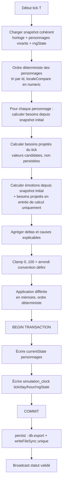
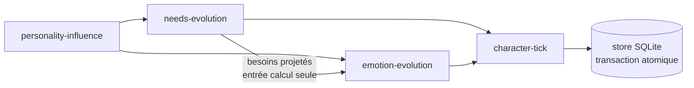

# Règles de tick personnage — conception Phase 3B

> **Statut : proposition documentaire. Aucun code métier de tick n'est implémenté.**
> Ce document définit le contrat futur d'évolution des personnages au tick (besoins + émotions).
> Il ne modifie ni le moteur, ni le worker, ni SQLite, ni l'UI, ni les IPC.

## 1. Audit de l'existant (réel)

| Élément | État réel | Impact Phase 3B |
|---|---|---|
| `stepSimulation` (`src/main/services/world-store.service.ts`) | Avance uniquement l'horloge dans transaction SQLite + `persist(db)`. | Doit être étendu pour appliquer les deltas personnage dans la **même transaction**. |
| `SimulationClock` | `tick/day/hour/status/speed/rngState/lastProcessedOrder`, 1 tick=1h, 24/jour. | `rngState` à persister après consommation éventuelle du PRNG. |
| `CharacterInstance` | `initialState` immuable après démarrage, `currentState` évolutif. | Seul `currentState` est modifié. |
| `SeededRng` | mulberry32 sérialisable `getState/setState` uint32. | Reprise déterministe possible ; ne pas consommer sans besoin. |
| Worker/Manager | Worker planifie/signale ; main valide, verrou par monde, écrit SQLite, broadcast. | Les règles métier restent côté main/services purs appelés par le store/manager. |
| Persistance | sql.js, `db.export()` + `writeFileSync` après mutation. | Un tick = une écriture disque cohérente. |

## 2. Périmètre strict

### Inclus (Phase 3B)
- Évolution des 8 besoins.
- Évolution des 10 émotions.
- Influence des traits de personnalité sur ces évolutions.
- Snapshot, application différée, déterminisme, explicabilité, calibration.

### Exclus
- Décisions autonomes, actions, planning, interactions sociales.
- Relations, événements, souvenirs, mort/deuil.
- LLM/OpenRouter, nouvelles fonctionnalités UI.
- Modification schéma SQLite, worker, IPC, preload.

## 3. Protocole de calcul d'un tick

### 3.1 Ordre définitif (proposé comme définitif pour Phase 3B)



### 3.2 Règle besoins projetés / émotions

**Décision proposée (définitive pour ce design)** : les émotions du tick `T` sont calculées à partir du **snapshot de début de tick** pour les traits et émotions, et des **besoins projetés du tick T** comme entrées de calcul uniquement.

Justification :
- Évite qu'une faim déjà calculée pour T n'influence les émotions seulement au tick T+1, ce qui créerait un retard artificiel d'une heure.
- Préserve l'absence de biais d'ordre : les besoins projetés sont dérivés du snapshot initial, pas de l'état déjà appliqué.
- Les besoins projetés ne sont **pas** persistés séparément et ne modifient pas le snapshot ; ils sont un artefact de calcul du tick.

Alternative rejetée : émotions uniquement sur snapshot besoins T. Plus simple, mais introduit un délai systématique peu naturel. À noter comme sensibilité de calibration.

### 3.3 Application différée

- Aucun delta n'est écrit dans le snapshot pendant la boucle de calcul.
- Tous les personnages sont calculés depuis le même état logique de début de tick.
- L'ordre de calcul n'a pas d'effet sur les résultats : on peut paralléliser en lecture plus tard, mais le résultat doit être identique.
- L'écriture finale suit un ordre déterministe (par `character.id` ascendant).

### 3.4 Atomicité

Une transaction SQLite par tick contient :
- mises à jour `characters.current_*_json`/champs miroir legacy nécessaires + `updated_at` ;
- mise à jour `simulation_clock` (`tick`, `day`, `hour`, `rng_state`, `last_processed_order`, `updated_at`, `status`) ;
- éventuellement `worlds.updated_at`/`status` si transition nécessaire.

Échec à n'importe quelle étape => `ROLLBACK`, aucun `persist`, état précédent conservé.

## 4. Déterminisme

### 4.1 Garanties

| Garantie | Statut | Mécanisme |
|---|---|---|
| Même entrée => même sortie | Définitif | Snapshot, ordre stable, pas d'aléa implicite. |
| Pas de `Date.now()` dans règles métier | Définitif | Horloge logique `tick/day/hour`; `Date.now()` uniquement métadonnées persistées hors calcul. |
| Pas de `Math.random()` | Définitif | `SeededRng` uniquement. |
| PRNG non consommé par règles passives | Définitif (Phase 3B) | Les formules besoins/émotions Phase 3B sont déterministes sans tirage ; ne pas appeler `rng.next()`. |
| Ordre de traitement stable | Définitif | `ORDER BY id` / tri `localeCompare('en', {numeric:true})` sur IDs. |
| Reproductible après redémarrage | Définitif | `rngState` persisté dans `simulation_clock`; snapshot état persisté. |
| Sérialisation stable | Définitif | Écriture JSON avec structure de clés fixe; arrondi déterministe. |

### 4.2 PRNG

- Le PRNG simulation est initialisé depuis `world.seed ^ 0x85ebca6b` (Phase 3A).
- **Phase 3B** : aucune consommation prévue. Si une future règle introduit une variabilité, elle doit : déclarer sa consommation, être documentée, testée par rejeu, et persister `rngState` après le dernier tirage du tick.
- `lastProcessedOrder` reste 0 en Phase 3B sauf si un traitement intra-tick ordonné plus fin est introduit.

### 4.3 Arrondi et précision

- Calcul interne : `number` (IEEE 754) acceptable en Phase 3B si les formules restent simples ; **provisoire**. Alternative plus robuste : centièmes entiers (`value * 100`).
- Arrondi final de persistance : `roundHalfEven` vers entier 0-100 (proposé) pour limiter la dérive statistique longue. Alternative : `Math.round` half-up. **À trancher avant implémentation**.
- Clamp final : `Math.min(100, Math.max(0, rounded))`.
- Les valeurs persistées sont des entiers 0-100, comme le contrat actuel.

## 5. Explicabilité

### 5.1 Format `TickDelta[]` (proposé)

```ts
interface TickDelta {
  entityId: string;          // characterId
  field: string;             // ex: "needs.hunger", "emotions.stress"
  before: number;
  after: number;
  delta: number;             // after - before
  causes: TickDeltaCause[];
  ruleId: string;            // ex: "needs.hunger.decay", "emotions.stress.need_pressure"
}

interface TickDeltaCause {
  kind: 'need_deficit' | 'emotion_pressure' | 'trait_modifier' | 'baseline_recovery' | 'clamp';
  source: string;            // ex: "needs.sleep", "traits.resilience"
  weight?: number;
  contribution?: number;     // contribution au delta avant clamp
  note?: string;
}
```

### 5.2 Règles d'explicabilité

- Toute évolution > 0 en valeur absolue après arrondi doit avoir au moins une cause.
- Les causes listent les contributions principales (top N ou seuil minimal), pas obligatoirement tous les micro-termes.
- Les deltas clampés/arrondis indiquent `clamp` ou `rounding` dans les causes si l'effet est significatif.
- Les logs/deltas détaillés sont **optionnels** en persistance normale (volume) ; ils peuvent être activés en mode diagnostic/test. **Décision d'implémentation future**.

## 6. Contrats TypeScript proposés (documentaires, non implémentés)

```ts
// Tous types indicatifs, à adapter à src/shared lors de l'implémentation.

export interface CharacterTickInput {
  worldId: string;
  tick: number;
  day: number;
  hour: number;
  seed: number;
  rngState: number; // uint32, inchangé en Phase 3B si pas de tirage
  characters: CharacterTickSnapshot[]; // ordre déterministe
  params: SimulationParameters; // versionné
}

export interface CharacterTickSnapshot {
  characterId: string;
  traits: CharacterTraits;       // lecture seule
  needs: CharacterNeeds;         // snapshot début tick
  emotions: CharacterEmotions;   // snapshot début tick
  goals: CharacterGoal[];        // lecture seule Phase 3B
}

export interface NeedDelta {
  characterId: string;
  field: keyof CharacterNeeds;
  before: number;
  after: number;
  delta: number;
  causes: TickDeltaCause[];
  ruleId: string;
}

export interface EmotionDelta {
  characterId: string;
  field: keyof CharacterEmotions;
  before: number;
  after: number;
  delta: number;
  causes: TickDeltaCause[];
  ruleId: string;
}

export interface CharacterTickResult {
  worldId: string;
  tick: number;
  rngState: number;              // identique en Phase 3B sans tirage
  characterStates: Array<{
    characterId: string;
    needs: CharacterNeeds;
    emotions: CharacterEmotions;
  }>;
  deltas: TickDelta[];
  warnings: string[];            // ex: clamp, valeur extrême
}

export interface TickRuleContext {
  params: SimulationParameters;
  /** PRNG disponible mais à ne pas consommer sans règle déclarée. */
  rng?: { getState(): number; next(): number };
}
```

Notes :
- `SimulationParameters` doit être versionné et persisté/référencé avec la simulation pour rejeu strict.
- `CharacterTickResult` ne doit pas contenir d'effets Electron/SQLite.

## 7. Architecture future (services purs)

| Service | Responsabilité | Entrée | Sortie |
|---|---|---|---|
| `personality-influence.service.ts` | Calculer modificateurs/baselines à partir des traits pertinents. | traits, clés pertinentes, params | coefficients/modificateurs bornés |
| `needs-evolution.service.ts` | Calculer besoins projetés et `NeedDelta[]` depuis snapshot. | snapshot personnage, params | needs projetés + deltas |
| `emotion-evolution.service.ts` | Calculer émotions projetées et `EmotionDelta[]`. | snapshot, besoins projetés, params | émotions projetées + deltas |
| `character-tick.service.ts` | Orchestrer snapshot, appels purs, agrégation, clamp/arrondi, ordre déterministe. | `CharacterTickInput` | `CharacterTickResult` |



Contraintes :
- Fonctions pures, sans import Electron/SQLite/renderer.
- Testables avec Vitest en Node.
- `character-tick.service.ts` n'écrit pas en base; il retourne un résultat appliqué par le store dans une transaction.


## 8. Calibration et simulations longues

### 8.1 Horizons de test

| Horizon | Ticks | Objectif |
|---:|---:|---|
| 1 jour | 24 | Vérifier dérives horaires, pas de saut brutal, bornes. |
| 3 jours | 72 | Observer accumulation besoins/émotions sans actions. |
| 1 semaine | 168 | Détecter saturation prématurée, boucles, oscillations. |
| 30 jours | 720 | Vérifier stabilité numérique, tendances longues, plafonds. |
| Longue durée | 5 000 - 10 000 | Détecter dérive d'arrondi, états absorbants irréalistes, performance/volume deltas. |

### 8.2 Profils de test

| Profil | Traits clés (indicatifs) | Attendu qualitatif |
|---|---|---|
| Optimiste résilient | optimism 80, resilience 80, discipline 60 | Récupération émotionnelle plus rapide, stress/anxiété moins persistants. |
| Anxieux peu résilient | anxiety-traits via timidity 75, distrust 70, courage 30, resilience 25 | Anxiety/fear/stress montent plus vite et redescendent plus lentement; safety plus sensible. |
| Discipliné | discipline 85, impulsivity 25, patience 70 | Dérive besoins légèrement mieux contenue (faible effet passif), satisfaction plus stable. |
| Impulsif | impulsivity 85, discipline 20, patience 30 | Dérives légèrement pires, anger/stress plus réactifs. |
| Très sociable | sociability 90, independence 20 | Socialization décroît plus vite, loneliness/sadness plus sensibles au déficit social. |
| Indépendant | sociability 30, independence 85 | Socialization décroît plus lentement, loneliness moins amplifiée. |

> Les profils doivent partager le même état initial de besoins/émotions pour isoler l'effet personnalité, puis être testés aussi avec états initiaux différents.

### 8.3 Critères d'échec

- **Saturation permanente** : une valeur reste bloquée à 0 ou 100 pendant une longue période sans cause active persistante.
- **Oscillation artificielle** : alternance régulière haut/bas sur besoins stables due à arrondi/couplage.
- **Stagnation totale** : aucun delta sur profils et états variés alors que des déficits existent.
- **Dégradation trop rapide** : health critique ou besoins à 0 en quelques ticks sans modèle intentionnel.
- **Explosion numérique** : NaN, Infinity, hors bornes, ou deltas incohérents.
- **Non-déterminisme** : deux rejeux identiques produisent des états/deltas différents.

### 8.4 Méthode de calibration (proposée)

1. Définir paramètres dans un objet versionné (`SimulationParametersV1`).
2. Exécuter simulations pures hors Electron/SQLite (fonctions pures).
3. Capturer séries temporelles min/max/moyenne/variance par besoin et émotion.
4. Ajuster un coefficient à la fois; documenter chaque changement.
5. Rejouer les scénarios de non-régression déterministes.
6. Ne valider qu'avec tests automatisés et rapport de calibration.


## 9. Décisions, hypothèses, points à calibrer

### 9.1 Décisions définitives (design Phase 3B)
- Périmètre besoins + émotions + traits uniquement.
- Snapshot cohérent début de tick.
- Besoins calculés depuis le snapshot, émotions avec besoins projetés en entrée de calcul.
- Application différée, ordre déterministe.
- Atomicité tick+horloge+personnages dans une transaction et un `persist`.
- Aucun PRNG consommé en Phase 3B.
- Aucun `Date.now()`/`Math.random()` dans règles métier.
- Services purs, testables sans Electron/SQLite/renderer.
- `TickDelta[]` pour explicabilité.

### 9.2 Hypothèses provisoires
- Arrondi `roundHalfEven` vers entiers (alternative half-up).
- Calcul interne en `number` IEEE 754 (alternative centièmes entiers).
- Baselines émotionnelles et taux/récupération proposés dans `EMOTION_EVOLUTION.md`.
- Coefficients de dérive et influences proposés dans `NEEDS_EVOLUTION.md`.
- Plafonds de delta/pression et zone morte de retour baseline.

### 9.3 À calibrer par tests
- Taux de dérive par besoin, surtout thirst/hunger/energy/sleep.
- Force réelle de l'influence traits (éviter sur-déterminisme).
- Poids besoin->émotion et émotion->émotion (anti-boucles).
- Dynamique `safety` sans événements.
- Longue dérive/arrondi sur 10 000 ticks.
- Volume acceptable de deltas détaillés en persistance/logs.

### 9.4 Liens
- `docs/NEEDS_EVOLUTION.md` — règles détaillées des 8 besoins.
- `docs/EMOTION_EVOLUTION.md` — règles détaillées des 10 émotions.
- `docs/SIMULATION_TIME_AND_ENGINE.md` — horloge, déterminisme, worker/main.
- `docs/CHARACTER_STATE_ARCHITECTURE.md` — initialState/currentState, snapshot, cohérence.
- `docs/DATABASE.md` — schéma actuel et contrainte transactionnelle.
