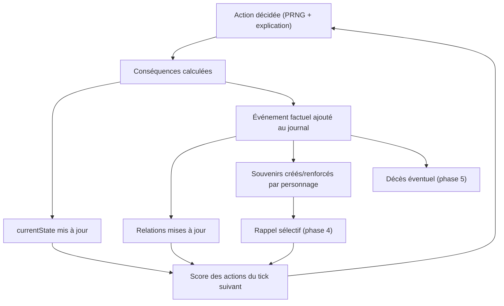

# Événements, historique et souvenirs — conception Phase 2

> **Statut : proposition architecturale. Aucun événement, historique ni souvenir n'est
> implémenté aujourd'hui.** Ce document unifie et précise les notes préexistantes
> `docs/EVENT_SYSTEM.md` et `docs/MEMORY_SYSTEM.md` (qui restent en place comme références
> historiques) et définit le contrat cible pour les phases 3 à 5. Aucun code, aucune table
> et aucune modification de schéma dans cette tranche.

## 1. Audit : ce qui existe et ce qui manque

- Existe : les types `CharacterState` (traits/émotions/besoins/objectifs), les colonnes
  `initial_*_json` / `current_*_json`, le statut `worlds.status`, un PRNG déterministe,
  une persistance SQLite fiable, des tests de CRUD/migration.
- N'existe pas : table d'événements, journal, table de souvenirs, moteur, tick, décision,
  `src/main/simulation/` est vide. Aucun `DecisionExplanation`, aucun type `EventType`,
  aucun appel LLM. Les docs `EVENT_SYSTEM.md` / `MEMORY_SYSTEM.md` décrivent des cibles
  [Planifié], pas du fonctionnel.
- Conséquence : il n'existe aujourd'hui **aucune traçabilité** d'un changement d'état.
  Le seul horodatage est `characters.updated_at` (date réelle de dernière écriture).

## 2. Trois notions à ne pas confondre

| Notion | Question qu'elle répond | Propriété | Durée de vie | Qui la lit |
|---|---|---|---|---|
| **État courant** (`currentState`) | « Quelle est la situation maintenant ? » | Objectif, unique par personnage, écrasé à chaque tick | Instantané, remplacé | Moteur, UI fiche |
| **Historique / journal des événements** | « Qu'est-il arrivé dans ce monde, dans l'ordre ? » | Objectif, factuel, immuable après écriture, source de vérité des causes | Complet, persistant, non modifiable | Moteur (conséquences), UI journal, audit |
| **Souvenirs personnels** | « Qu'est-ce que ce personnage croit se souvenir ? » | Subjectif, propre à chaque personnage, déformable/oubliable | Consolidé, filtré, parfois estompé | Moteur (score d'actions), dialogues LLM (extraits seulement) |



**Règle d'or** : un souvenir n'est jamais la source de vérité d'un fait. Si un souvenir
et un événement divergent, l'événement gagne ; le souvenir est une perception, pas une
donnée canonique. Le journal n'est jamais modifié pour « corriger » un souvenir.

## 3. Événements et historique

### 3.1 Types d'événements cibles (`EventType` — [Planifié])

`world_start`, `meeting`, `conversation`, `conflict`, `argument`, `reconciliation`,
`betrayal`, `help`, `act_of_courage`, `act_of_cowardice`, `jealousy`, `falling_in_love`,
`breakup`, `emotion_change`, `relationship_change`, `goal_progress`, `goal_completed`,
`goal_failed`, `need_critical`, `accident`, `illness`, `injury`, `discovery`,
`loneliness`, `psychological_crisis`, `trait_change`, `death`, `world_pause`,
`world_resume`.

La liste est ouverte mais tout nouveau type doit être ajouté avec : un libellé FR, une
règle de conséquence (ou une justification « sans conséquence automatique »), un test,
et une décision sur le souvenir laissé chez chaque participant.

### 3.2 Structure proposée (`src/shared/event.ts` — [Planifié])

```ts
export interface WorldEvent {
  id: string;                 // UUID
  worldId: string;            // isolation stricte
  tick: number;               // temps interne, pas Date.now()
  order: number;              // rang dans le tick (déterminisme)
  type: EventType;
  summary: string;            // description factuelle courte, FR
  details?: string;           // contexte factuel supplémentaire
  subjectId: string | null;   // acteur principal
  participantIds: string[];   // autres protagonistes, ordre déterministe
  location: string | null;    // [Planifié] lieu; nullable tant qu'il n'existe pas de lieux
  importance: number;         // 0-100, importance objective pour le monde
  cause: { kind: 'action' | 'need' | 'relation' | 'event' | 'death' | 'world'; refId?: string } | null;
  deltas: StateChange[];      // avant/après : émotions, besoins, relations, objectifs
  sourceDecisionId?: string;  // explicabilité : décision d'origine
  createdAt: string;          // date réelle d'écriture (diagnostic uniquement)
}

export interface StateChange {
  targetId: string;
  field: string;              // ex. "emotions.anger", "relationship.trust:B"
  before: number | string | null;
  after: number | string | null;
}
```

`DecisionExplanation` (déjà esquissé dans `docs/SIMULATION_ENGINE.md`) reste **séparé**
de l'événement : il contient le score de chaque action candidate, les facteurs dominants,
l'état du PRNG au moment du choix, le tick et l'action retenue. Un événement peut référencer
une explication par `sourceDecisionId` ; l'explication n'est pas un souvenir et n'influence
pas le monde.

### 3.3 Historique : responsabilités

- Table `events` **[Planifié]** : `id`, `world_id`, `tick`, `order`, `type`, `payload_json`,
  `importance`, `created_at`. Index `(world_id, tick, order)`. PK + `UNIQUE(world_id, tick, order)`
  pour garantir un ordre stable.
- **Immuabilité** : aucune mise à jour d'un événement déjà écrit. Un « correctif » est un
  nouvel événement qui référence l'ancien (`cause.kind = 'event'`). Cela préserve l'audit.
- **Pas de suppression automatique** : le journal complet persiste. L'UI peut n'afficher
  qu'une fenêtre glissante (500 entrées, comme proposé dans `docs/SIMULATION_ENGINE.md`),
  mais c'est un choix d'affichage, pas une purge de données.
- **Persistance** : écrite dans la même transaction que l'état et les relations du tick.
  Aucun événement orphelin si le tick échoue.
- **[Planifié]** filtres UI : tous, relations, émotions, conflits, accidents, décès,
  conversations ; consultation par personnage et par tick.

### 3.4 Émergence et cascades

Un événement résulte toujours d'une action simulée, d'une conséquence d'état ou d'un
changement de relation — jamais d'un tirage isolé sans cause. Les cascades sont des
**règles pures** dans `src/main/simulation/event-rules.ts` **[Planifié]** :

1. l'événement source est validé (type, participants appartenant au monde) ;
2. ses conséquences sont calculées à partir de l'état courant et des traits ;
3. chaque conséquence produit un `StateChange` explicite ;
4. chaque participant concerné reçoit un souvenir (si la règle le prévoit) ;
5. les événements dérivés sont ajoutés avec `tick` identique et `order` incrémenté ;
6. profondeur de cascade bornée (à calibrer) pour éviter les boucles infinies.

Exemple : une insulte → colère de la victime + baisse de confiance envers l'agresseur +
respect réduit chez un témoin + souvenir de l'insulte chez la victime. Rien de tout cela
n'est écrit directement dans `initialState`.

## 4. Souvenirs personnels

### 4.1 Différence avec l'historique

L'historique est ce qui **s'est passé** ; le souvenir est ce que **chaque personnage en
garde**. Deux témoins du même événement n'ont pas les mêmes souvenirs : importance,
valence et associations diffèrent selon leurs traits, leur état et leurs relations au
moment de l'événement.

### 4.2 Structure proposée (`src/shared/memory.ts` — [Planifié])

```ts
export interface Memory {
  id: string;
  worldId: string;
  ownerId: string;            // le personnage qui se souvient
  sourceEventId: string;      // ancrage factuel obligatoire
  tick: number;               // tick de création
  lastReinforcedTick: number;
  type: EventType | 'reflection';
  description: string;        // formulation subjective, FR
  importance: number;         // 0-100, propre au personnage
  valence: number;            // -100 à +100
  intensity: number;          // 0-100
  linkedCharacterIds: string[];
  /** 'active' | 'faded' : un souvenir oublié n'est pas supprimé. */
  status: 'active' | 'faded';
  recallCount: number;        // statistique d'usage, pour calibrer le rappel
}
```

### 4.3 Consolidation et oubli

- Importance effective = `importance × facteur de récence × renforcement` (formules à
  calibrer, pas de valeurs définitives ici).
- Un souvenir non renforcé passe en `faded` sous un seuil ; il conserve une trace minimale
  et n'est plus rappelé par défaut. Les traumatismes et moments heureux très importants
  résistent plus longtemps.
- Aucune suppression physique pendant la simulation : l'oubli est un **état**, pas un `DELETE`.
- Le rappel sélectionne un petit nombre de souvenirs par pertinence (participants, type,
  valence, récence, importance) avant d'influencer le score des actions.
- **LLM** (phase 6) : seuls les souvenirs sélectionnés peuvent être transmis pour
  contextualiser un dialogue. Le LLM ne peut ni créer, ni modifier, ni hiérarchiser un
  souvenir : il n'écrit que du texte de dialogue candidates, validé ensuite par le moteur.

### 4.4 Table SQLite proposée (`memories` — [Planifié])

`id` TEXT PK, `world_id` / `owner_id` / `source_event_id` TEXT NOT NULL (FK vers
`characters` / `events` avec `ON DELETE CASCADE` pour `owner_id` uniquement), `tick`
INTEGER, `payload_json` TEXT NOT NULL, `status` TEXT, `created_at` / `updated_at` TEXT.
Index `(world_id, owner_id, status)`, `(world_id, source_event_id)`. Aucune de ces tables
n'est à créer maintenant ; aucune colonne existante ne sera touchée.

## 5. Mort et historique (articulation avec `docs/DEATH_SYSTEM.md`)

La mort est un événement de plus, avec conséquences particulières : statut `alive = false`
(**[Planifié]**), arrêt des décisions et des besoins, conservation du profil, des relations
et des souvenirs. Un événement `death` est ajouté avec cause cohérente (âge, maladie,
blessure, besoin critique), jamais tiré au hasard. Les survivants reçoivent des souvenirs
et des réactions émotionnelles différenciées. Les souvenirs du défunt restent lisibles
pour audit ; ils ne sont plus rappelés par le moteur.

## 6. Tests à prévoir quand ce sera implémenté

1. Un événement est écrit avec `tick`/`order` stables et immuable après rechargement.
2. Un changement d'état est toujours accompagné d'un `StateChange` dans un événement.
3. Cascade bornée : pas de boucle, ordre des événements dérivés déterministe.
4. Deux personnages témoins du même événement ont des souvenirs distincts.
5. Un souvenir `faded` n'est pas rappelé mais reste en base.
6. Échec en milieu de tick : rollback de l'état, des relations, des événements et des souvenirs.
7. Même seed + même actions → mêmes événements et mêmes souvenirs.
8. Aucune donnée LLM ne modifie un événement, un souvenir ou une décision.
9. Suppression d'un personnage en préparation n'affecte aucun événement d'un autre monde
   (isolation `world_id`).
10. Migration additive sur une base Phase 1/2 existante : lectures inchangées.

## 7. Questions ouvertes

- Faut-il stocker le `DecisionExplanation` en table dédiée ou dans `payload_json` de
  l'événement ? Proposition : table dédiée si le volume devient élevé, sinon JSON ;
  à arbitrer au moment de la phase 3.
- Quelle profondeur de cascade et quel budget d'événements par tick ? À calibrer par
  simulation longue, pas par intuition.
- Faut-il un « résumé de chapitre » périodique (journal agrégé) ? **[Planifié]** si l'UI
  de phase 7 le demande, sans remplacer le journal détaillé.

## Liens

- `docs/EVENT_SYSTEM.md` et `docs/MEMORY_SYSTEM.md` — notes initiales conservées.
- `docs/CHARACTER_STATE_ARCHITECTURE.md` — origine des changements d'état.
- `docs/RELATIONSHIP_SYSTEM.md` — événements à l'origine des changements de relation.
- `docs/SIMULATION_TIME_AND_ENGINE.md` — tick, ordre, seed et reprise.
- `docs/SIMULATION_ENGINE.md` — cycle de 16 étapes préexistant.
