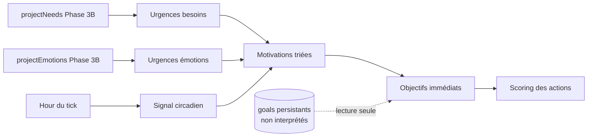

# Sélection des objectifs et des motivations — conception Phase 3C

> **Statut : proposition architecturale. Aucun objectif immédiat, aucune motivation ni
> aucune modification d'objectif n'est implémenté dans cette tranche.** Tranche strictement
> documentaire : aucun code applicatif, schéma SQLite, IPC, UI ou LLM modifié.
> Source de vérité de l'existant : `src/shared/character.ts`,
> `src/main/services/character-validation.service.ts`,
> `src/main/services/character-tick.service.ts`, `docs/CHARACTER_STATE_ARCHITECTURE.md`.

## 1. Audit de l'existant (vérifié dans le code)

| Élément | État réel | Conséquence pour la conception |
|---|---|---|
| `CharacterGoal` | `{ id: string; label: string; kind: 'primary' \| 'secondary' }`. Aucun statut, progression, échéance, cible numérique ni référence à un besoin. | Le `label` est du **texte libre** : aucune correspondance fiable avec une action n'est possible sans interprétation sémantique. |
| Validation | `validateGoals()` impose **exactement 1 objectif principal et 2 secondaires**, puis les réordonne `[primary, secondary, secondary]`. | Ce contrat doit rester vrai après la simulation. |
| Persistance | `initial_goals_json` et `current_goals_json` existent ; Phase 3B n'écrit que `*_emotions_json` / `*_needs_json`. | `current_goals_json` reste inchangé par le tick Phase 3C. |
| Snapshot | `CharacterTickSnapshot.goals` est en lecture seule. | Les objectifs immédiats sont calculés, pas stockés dans `goals`. |
| Données structurées disponibles | 21 traits, 8 besoins (100 = satisfait), 10 émotions, `tick/day/hour`, liste des personnages du monde. | Les motivations sont dérivables de ces seules données. |
| PRNG | `SeededRng` sérialisable, non consommé en Phase 3B. | Aucun tirage n'est nécessaire pour sélectionner un objectif immédiat. |

## 2. Trois notions distinctes

| Notion | Définition | Persistance | Qui la lit |
|---|---|---|---|
| **Objectif persistant** (`CharacterGoal`) | Intention de fond définie à la création, 1 principal + 2 secondaires. | `initial_goals_json` / `current_goals_json`, **jamais modifié par le moteur** en Phase 3C. | Fiche personnage ; motivations futures [Reporté]. |
| **Motivation** | Pression interne issue d'un besoin, d'une émotion, d'un trait ou de l'heure du tick. | Éphémère, recalculée à chaque tick. | Scoring des actions. |
| **Objectif immédiat** (`ImmediateGoal`) | Motivation dominante convertie en cible de court terme (ex. « rétablir l'hydratation »), avec un rang et une raison. | Éphémère, recalculée ; un résumé compact peut être conservé dans le runtime d'action. | Scoring, explicabilité, UI future. |

**Règle d'or** : un objectif immédiat n'est **jamais écrit** dans `current_goals_json`.
Il n'y a donc aucun « changement permanent d'objectif » automatisable en Phase 3C.

## 3. Urgences des besoins

L'urgence d'un besoin est calculée depuis les **besoins projetés du tick** (résultat de
`projectNeeds()` en Phase 3B) et du delta passif observé. Elle réutilise le helper existant
`deficitPressure(value, threshold)` de `personality-influence.service.ts`.

```text
deficit_b      = deficitPressure(projectedNeeds[b], deficitThreshold_b)          // dans [0, 1]
excesPerte_b   = max(0, (-needDelta_b) - referenceDecay_b)
trend_b        = clamp01(excesPerte_b / referenceDecay_b)                        // dans [0, 1]
urgency_b      = clamp01(deficit_b * criticality_b + trendWeight * trend_b)
```

- `deficitThreshold_b` : seuil de gêne en points 0–100. Valeur réelle par défaut = 60
  (`DEFAULT_SIMULATION_PARAMETERS.deficitThreshold`). Le commentaire du contrat
  `SimulationParametersV1.deficitThreshold` mentionne 80 : divergence de commentaire
  relevée, sans effet sur le comportement exécuté. À corriger en tranche dédiée.
- `referenceDecay_b` : dérive de référence, issue des coefficients Phase 3B
  (`params.needs[b].decay`), majorée d'un plancher pour éviter la division par zéro
  (`safety` et `health` ont `decay = 0`). [Hypothèse] plancher = 0.5.
- `needDelta_b` : delta passif du tick (avant effets d'action), déjà calculé par
  `needs-evolution.service.ts`. Une action ne modifie **pas** l'urgence du tick courant.
- `trend_b` mesure donc l'accélération **au-delà de la dérive normale**, pas la dérive
  elle-même : un besoin qui suit sa dégradation habituelle ne génère pas d'urgence de tendance.
- `trendWeight` : [Hypothèse] 0.20.
- `criticality_b` : poids de survie, [hypothèses] :

| Besoin | `criticality` | Justification qualitative |
|---|---:|---|
| `thirst` | 1.00 | Dégradation la plus rapide, effet santé direct. |
| `hunger` | 0.95 | Besoin primaire. |
| `sleep` | 0.90 | Effet cumulatif sur énergie et émotions. |
| `health` | 0.90 | État critique, mais pas de déclin naturel. |
| `energy` | 0.80 | Permet l'action, mais récupérable. |
| `safety` | 0.75 | Pas de déclin naturel en Phase 3B. |
| `socialization` | 0.60 | Important mais non vital. |
| `hygiene` | 0.50 | Confort et santé secondaire. |

Propriétés testables :
- `urgency_b = 0` si `projectedNeeds[b] >= deficitThreshold_b` et `trend_b = 0` ;
- au-dessus du seuil, une accélération au-delà de la dérive de référence peut produire
  une motivation, bornée à `trendWeight` ;
- `urgency_b <= 1` pour toute entrée dans `[0, 100]` ;
- un besoin à 0 a une urgence plus élevée qu'un besoin à 50, à criticalité égale ;
- un besoin en forte dégradation est plus urgent qu'un besoin stable au même niveau.

## 4. Urgences émotionnelles

Chaque émotion possède une **direction de soulagement** : les émotions dites négatives
doivent baisser, les positives doivent monter. On réutilise `emotionPressure()` et
`lowEmotionPressure()` existants avec `params.emotionThreshold` (défaut 50).

```text
si direction = decrease : emotionalUrgency_e = emotionPressure(value, emotionThreshold)
si direction = increase : emotionalUrgency_e = lowEmotionPressure(value, emotionThreshold)
```

| Émotion | Direction | Raison |
|---|---|---|
| `sadness`, `stress`, `anxiety`, `anger`, `fear`, `loneliness` | `decrease` | Soulager une pression négative. |
| `happiness`, `confidence`, `motivation`, `satisfaction` | `increase` | Restaurer un état positif. |

Décisions :
- Aucune urgence émotionnelle ne peut être négative ; elle est bornée dans `[0, 1]`.
- Les baselines émotionnelles calculées en Phase 3B ne sont pas réécrites : l'urgence
  mesure un écart au seuil, pas un écart à la baseline (évite un double objectif).
- Les émotions ne sont **pas** des causes directes de changement de besoin : elles
  n'influencent que le score des actions (voir `ACTION_SYSTEM.md` §5 et
  `AUTONOMOUS_DECISION_SYSTEM.md` §7).

## 5. Objectifs immédiats

### 5.1 Construction

```text
motivations  = [urgences besoins (source='need'), urgences émotions (source='emotion'),
                signaux circadiens (source='circadian')]
groupes      = regroupement par (targetKey, direction) ; ex. need:sleep + circadian:night
                -> objectif 'rest:sleep'
urgenceGroupe = maximum des urgences du groupe
groupes triés par urgenceGroupe décroissante, puis identifiant lexicographique croissant
immediateGoals = premiers groupes dont urgenceGroupe >= minimumMotivationUrgency,
                 limités à IMMEDIATE_GOAL_LIMIT
```

- [Hypothèses] `minimumMotivationUrgency = 0.25`, `IMMEDIATE_GOAL_LIMIT = 3`.
- Un signal circadien est dérivé de `hour` : `night` si `hour >= 22 || hour < 7`,
  avec une urgence fixe [hypothèse] 0.30 et `targetKey: 'sleep'`. Ce signal n'impose pas
  de contrainte (pas de « il doit dormir »), il ne fait que pondérer le score de `sleep`.
- Le regroupement évite deux objectifs concurrents pour la même cible (besoin de sommeil
  et signal nocturne). Le tri par identifiant lexicographique garantit un résultat
  indépendant de l'ordre des objets JavaScript et de l'ordre des personnages.

### 5.2 Stabilité et hystérésis

Les objectifs immédiats sont recalculés à chaque tick, mais leur **rang** ne doit pas
osciller pour des écarts insignifiants. Règle proposée :

```text
un objectif déjà présent au tick précédent conserve son rang s'il reste au-dessus de
minimumMotivationUrgency ET si son urgence n'a pas chuté de plus de demotionDrop (0.10)
sous l'urgence du candidat suivant.
```

- L'état nécessaire (`previousImmediateGoals` : identifiant + urgence) est [Reporté]
  stocké dans `CharacterActionRuntime` (déjà prévu pour l'historique des actions).
- Sans cet état, la Phase 3C peut fonctionner en mode **sans hystérésis** : le calcul reste
  déterministe et rejeable ; l'hystérésis est une amélioration de stabilité, pas une
  condition de correction.
- **Décision** : l'hystérésis ne doit jamais modifier une valeur persistée ni geler un
  besoin critique : si `urgency >= criticalUrgency` (provisoire 0.85), l'objectif critique
  passe toujours en premier, quel que soit le rang précédent.

### 5.3 Pourquoi les objectifs persistants n'influencent pas encore le score

**Décision explicite** : en Phase 3C, `CharacterGoal.label` n'est **pas interprété**.

Raisons :
1. `label` est du texte libre saisi par l'utilisateur ; aucune ontologie, aucun
   `goalType`, aucune cible numérique ni aucun lien vers un besoin n'existe.
2. Une correspondance textuelle (« devenir médecin » → `practice_activity`) serait une
   heuristique fragile, non testable de façon générale et dépendante de la langue.
3. Le LLM est interdit pour la décision et les conséquences (AGENTS.md §3 et §8).
4. Faire varier le score selon `kind` seul n'apporterait aucun départage, puisque
   `kind` est identique pour toutes les actions d'un même personnage.

Par conséquent :
- les objectifs persistants restent **lisibles et persistés**, et sont copiés dans le
  snapshot pour les phases futures ;
- ils ne départagent **aucune action** en Phase 3C ;
- toute règle future doit passer par une structure explicite (extension `CharacterGoalV2`
  ci-dessus et contrats §7).

[Reporté] Extension de `CharacterGoal` :

```ts
interface CharacterGoalV2 {
  id: string;
  label: string;
  kind: 'primary' | 'secondary';
  /** Nouveauté proposée : cibles structurées, remplaçant toute interprétation du label. */
  targetNeeds?: Partial<Record<NeedKey, number>>;
  targetEmotions?: Partial<Record<EmotionKey, number>>;
  preferredActionIds?: readonly ActionId[];
  status?: 'active' | 'completed' | 'abandoned';
}
```

Cette extension nécessitera une migration additive et une décision produit séparée ;
elle est **hors du périmètre de cette tranche documentaire**.

## 6. Conflits de motivations

Plusieurs motivations peuvent viser la même action (ex. `sleep` satisfait à la fois
`sleep`, `energy` et le signal nocturne) ou des actions opposées (`be_alone` réduit la
socialisation alors que `seek_company` l'augmente). Règles :

1. **Additivité contrôlée** : le score d'une action somme les contributions de chaque
   motivation, puis est borné (voir `AUTONOMOUS_DECISION_SYSTEM.md` §7). Aucune motivation
   ne « gagne » par écrasement.
2. **Conflit par coût** : une action qui réduit un besoin déjà urgent est pénalisée via
   son `costs` pondéré par l'urgence ; elle n'est pas interdite (ex. dormir coûte un peu
   d'hydratation).
3. **Pas de priorité absolue entre besoins** : la criticité est un poids, pas un verdict.
   Un besoin à 20 peut être momentanément laissé si une action plus bénéfique traite un
   besoin à 10 avec un gain plus fort.
4. **Interdiction de modification croisée** : une motivation émotionnelle ne modifie
   jamais directement un besoin, et réciproquement. Seules les actions ont des effets.

## 7. Contrats TypeScript proposés (non implémentés)

```ts
export type MotivationSource = 'need' | 'emotion' | 'circadian';

export interface Motivation {
  /** Exemple : "need:thirst", "emotion:stress", "circadian:night". */
  id: string;
  source: MotivationSource;
  /** Clé du besoin ou de l'émotion, ou "night". */
  refKey: NeedKey | EmotionKey | 'night';
  /** Cible logique utilisée pour regrouper les motivations en objectif immédiat. */
  targetKey: NeedKey | EmotionKey;
  /** 0..1, calculé depuis les valeurs projetées du tick. */
  urgency: number;
  /** Direction souhaitée pour l'action cible. */
  direction: 'increase' | 'decrease';
  reason: string;
}

export interface ImmediateGoal {
  /** Exemple : "restore:thirst", "reduce:stress", "rest:night". */
  id: string;
  label: string;               // libellé FR déterministe, généré depuis la clé
  rank: number;                // 1 = prioritaire
  urgency: number;
  motivations: Motivation[];  // motivations regroupées sous ce but
  ruleId: string;              // ex. "goal.immediate.v1"
}

export interface GoalSelectionInput {
  characterId: string;
  tick: number;
  hour: number;
  /** Besoins projetés du tick courant (Phase 3B), non persistés séparément. */
  projectedNeeds: Readonly<CharacterNeeds>;
  /** Deltas passifs du tick, pour le terme de tendance. */
  needDeltas: Readonly<Record<NeedKey, number>>;
  emotions: Readonly<CharacterEmotions>;
  /** Objectifs persistants, lus mais non interprétés en Phase 3C. */
  goals: ReadonlyArray<{ id: string; label: string; kind: 'primary' | 'secondary' }>;
  params: SimulationParametersV1;
  /** Facultatif : état précédent pour hystérésis [Reporté]. */
  previous?: {
    immediateGoals: ReadonlyArray<{ id: string; urgency: number }>;
  };
}

export interface GoalSelectionResult {
  motivations: Motivation[];
  immediateGoals: ImmediateGoal[];
  /** Raisons d'exclusion, pour l'explicabilité. */
  excluded: Array<{ id: string; reason: string }>;
}
```

> Ces types sont **proposés** : aucun n'existe dans `src/shared` aujourd'hui.

## 8. Intégration dans le tick (proposée)



`goal-selection.service.ts` (proposé) reste **pur** : aucune écriture, aucun PRNG,
aucune dépendance Electron/SQLite/renderer. Il est appelé par `character-tick.service.ts`
entre `projectEmotions()` et la génération des candidats d'action.

## 9. Scénarios de tests futurs

1. **Bornes** : urgences dans `[0, 1]` pour besoins/émotions à 0, 50 et 100.
2. **Seuil** : aucun besoin au-dessus du seuil avec dérive normale ne produit de motivation ;
   une accélération au-delà de la dérive de référence peut en produire une.
3. **Criticité** : à besoin égal, `thirst` produit une urgence supérieure à `hygiene`.
4. **Tendance** : à besoin égal, une accélération au-delà de la dérive de référence produit
   une urgence supérieure.
5. **Émotions** : `stress` élevé produit une motivation `decrease` ;
   `happiness` basse produit une motivation `increase`.
6. **Circadien** : `hour = 23` produit `circadian:night`, `hour = 12` ne le produit pas.
7. **Tri stable** : deux jeux de motivations dans un ordre différent donnent les mêmes
   `immediateGoals` ; départage lexicographique en cas d'égalité d'urgence.
8. **Limite** : jamais plus de `IMMEDIATE_GOAL_LIMIT` objectifs immédiats.
9. **Non-modification** : après 1000 ticks, `current_goals_json` est octet pour octet
   identique à la valeur initiale.
10. **Hystérésis** [Reporté] : un objectif critique reprend le rang 1 même s'il était
    précédemment en rang 3.
11. **Indépendance** : deux personnages avec les mêmes besoins/émotions mais des objectifs
    persistants différents produisent les mêmes objectifs immédiats (conséquence directe
    de la décision §5.3).
12. **Rejeu** : même snapshot + mêmes paramètres → mêmes motivations, dans le même ordre.

## 10. Décisions, hypothèses, reporté

### Décisions définitives
- Séparation stricte objectif persistant / motivation / objectif immédiat.
- `current_goals_json` jamais modifié par le moteur en Phase 3C.
- `label` non interprété ; aucune heuristique textuelle, aucun LLM.
- Objectifs immédiats calculés depuis les seules données structurées.
- Urgences bornées `[0, 1]`, tri déterministe, pas de PRNG consommé.
- Conflits résolus par sommation pondérée et coûts, jamais par priorité absolue.

### Hypothèses configurables
- `deficitThreshold_b = 60`, `referenceDecay` plancher 0.5, `trendWeight = 0.20`,
  `minimumMotivationUrgency = 0.25`, `IMMEDIATE_GOAL_LIMIT = 3`,
  `criticalUrgency = 0.85`, urgence nocturne 0.30, table de criticité.

### Reporté
- Persistance de `previousImmediateGoals` (identifiant + urgence) et activation de l'hystérésis.
- Extension `CharacterGoalV2` (`targetNeeds`, `targetEmotions`, `preferredActionIds`,
  `status`) avec migration additive.
- Toute écriture d'objectif suite à un événement, une relation ou un souvenir.

## Liens

- `docs/AUTONOMOUS_DECISION_SYSTEM.md` — utilisation des urgences dans le score.
- `docs/ACTION_SYSTEM.md` — catalogue, effets et contraintes des actions.
- `docs/CHARACTER_STATE_ARCHITECTURE.md` — contrat `initialState` / `currentState`.
- `docs/CHARACTER_TICK_RULES.md` — snapshot, besoins projetés, déterminisme.
- `docs/NEEDS_EVOLUTION.md`, `docs/EMOTION_EVOLUTION.md` — origine des valeurs projetées.
