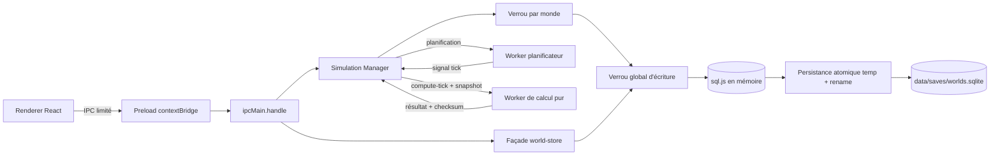

# Phase 3D — Consolidation du moteur

> **Statut : conception validée. La tranche 3D-A est implémentée et validée ; 3D-B à 3D-D
> restent planifiées et exigent une validation distincte.** HEAD avant conception 3D :
> `276384eb993e91f80a309e0864a54dbe1fdf8d53`, identique à `origin/main`. HEAD après
> publication de la conception : `e060a07a71cad43932444ae56a00de13d72a1cf0`.
> Ce document sert de référence d'architecture pour les tranches 3D-A à 3D-D.

## 1. Périmètre retenu

La Phase 3D consolide le moteur livré en Phase 3C avant toute nouvelle règle de gameplay.

Elle couvre :

1. un historique technique persistant, strictement validé, une décision par personnage et par tick ;
2. le déplacement du **calcul pur du tick** dans un worker dédié, le main restant propriétaire de SQLite ;
3. une persistance asynchrone, vérifiée et atomique au niveau fichier, avec restauration de l'état mémoire en cas d'échec ;
4. une refactorisation progressive de `world-store.service.ts` derrière une façade stable ;
5. une interface minimale et sobre : action courante, dernières actions, inspecteur de décision, filtres et rafraîchissement après tick.

Hors périmètre : environnement, lieux, ressources, relations, événements canoniques, souvenirs, mort, deuil, LLM/OpenRouter, UI avancée avec graphiques, `forkFromStopped`.

## 2. Correction de l'audit précédent

Les vérifications directes dans le code imposent plusieurs corrections à la recommandation initiale.

| Point | Recommandation précédente | Correction retenue | Raison vérifiée dans le code |
|---|---|---|---|
| Worker | Étendre `simulation.worker.ts` avec un message `compute-tick` | **Ajouter un second worker dédié** `tick-compute.worker.ts` ; le worker actuel reste planificateur | `simulation.worker.ts` gère déjà les intervalles par monde via `setInterval` ; son `handleCommand()` est synchrone. Mélanger calcul long et timer violerait « un fichier = une responsabilité » et retarderait les signaux. |
| Ordre des tranches | Calcul worker, persistance et historique dans une même phase | **Historique → persistance/verrou → worker → IPC/UI** | Le calcul asynchrone exige de séparer le verrou du monde du verrou global d'accès à SQLite. Poser les deux en même temps que le worker rendrait les régressions difficiles à isoler. |
| Table d'historique | FK `character_id → characters(id) ON DELETE CASCADE` | **Aucune FK sur `character_id`** ; FK `world_id → worlds(id) ON DELETE CASCADE` | L'historique est un audit : il doit survivre à la suppression d'une instance. La suppression d'un monde doit au contraire tout emporter. |
| Explication | `explanation_json` TEXT non compressé | **`payload_blob` BLOB zlib + hash SHA-256 + taille canonique bornée** | Le JSON complet contient 11 candidats, des motivations, des rejets, des effets et des états ; non compressé, il devient coûteux à 100 personnages et 10x. Les urgences ne sont pas dans `DecisionExplanation` actuel : elles seront ajoutées dans l'enveloppe `DecisionRecordV1`. |
| Migration | Introduire `schema_migrations` comme source de vérité | **Table `schema_migrations` complémentaire**, sans supprimer les `PRAGMA table_info` existants | Les bases legacy n'ont pas cette table ; la compatibilité doit rester fondée sur l'inspection réelle du schéma. |
| Persistance | `temp + rename` après `COMMIT` | **`COMMIT` puis écriture atomique, avec restauration de l'état mémoire depuis un export précédent en cas d'échec** | `stepSimulation()` fait aujourd'hui `COMMIT` puis `persist(db)`. Si `persist()` échoue, la base mémoire est déjà modifiée : il faut pouvoir revenir en arrière. |
| Refactorisation | Découper en plusieurs services dans la même tranche que le worker | **Façade `world-store.service.ts` conservée, modules extraits tranche par tranche** | IPC, tests et manager importent actuellement cette façade ; un big bang casserait la compatibilité. |
| UI | Afficher l'historique immédiatement | **UI en dernière tranche**, avec throttle et abonnement limité | Le renderer met déjà à jour statut et horloge via `simulation:status-changed`, mais ne recharge ni les personnages ni l'historique. Le throttle 500 ms ne s'applique qu'à ces rechargements. |
| `getWorld()` | Considéré comme lecture | **Écriture réelle de `last_opened_at` + `updated_at` + `persist()`** | Toute opération dite « lecture » peut écrire ; le verrou global doit donc couvrir ce chemin. |
| Verrous | Verrou global seul | **Ordre de verrou unique : verrou du monde puis verrou global d'écriture** | Le manager DETIENT déjà le verrou par monde autour des commandes/ticks. Inverser l'ordre pour la suppression créerait un risque d'interblocage. Le nettoyage actuel de `worldLocks` compare une promesse chaînée et ne supprime donc pas l'entrée : à corriger en 3D-B. |
| Erreurs worker | « Remonter à l'IPC » | **Step manuel : rejet IPC. Tick automatique : journalisation main, aucun état écrit, statut inchangé** | Un signal du planificateur n'a pas d'appelant IPC à qui renvoyer une erreur. |

Aucune suppression de champ ou de contrat n'est proposée dans cette phase. Les champs actuellement sans effet ou non interprétés sont **conservés** : `CharacterTickInput.seed`, `maxRngDrawsPerCharacterTick`, `caps.healthLoss`, `lastProcessedOrder` (validé et persisté, mais non utilisé par les règles), les `goals` de `GoalSelectionInput` (lus mais dont le libellé n'est pas interprété) et les messages `start`/`step` du worker (implémentés mais jamais envoyés par le manager). `world.seed` et `projectedEmotions` sont déjà utilisés dans le code réel et ne sont pas concernés par cette liste. Toute activation ou tout retrait fera l'objet d'une décision séparée et justifiée.

## 3. Architecture retenue



Principes :

- Le **main reste le seul propriétaire de SQLite** ; aucun worker n'ouvre le fichier ni n'appelle sql.js.
- Le worker de calcul reçoit des données sérialisables, ne dépend ni d'Electron ni de Node pour les règles, et renvoie un résultat pur.
- L'ordre des verrous est toujours **monde → global**. Le verrou **monde** est détenu pendant tout le tick, y compris l'attente du worker. Le verrou **global** ne couvre que les accès SQLite : lecture du snapshot, relecture de l'horloge après calcul, transaction, export et persistance. Il est relâché pendant `await compute-tick`, afin qu'un autre monde puisse écrire.
- La transaction SQLite ne reste jamais ouverte pendant l'aller-retour worker. Le snapshot est lu sous verrou global, le calcul est attendu sous verrou monde uniquement, puis le verrou global est repris pour relire l'horloge, valider l'absence de changement, et écrire états, historique, horloge et PRNG dans une transaction courte.
- L'export `beforeBuffer` est réalisé **après la reprise du verrou global et avant `BEGIN`**, afin de pouvoir restaurer exactement l'état mémoire du moment de l'écriture si la persistance échoue après `COMMIT`. Un export pris avant le calcul serait obsolète si un autre monde a écrit entre-temps.

Références détaillées :

- [DECISION_HISTORY_SYSTEM.md](DECISION_HISTORY_SYSTEM.md)
- [WORKER_TICK_PROTOCOL.md](WORKER_TICK_PROTOCOL.md)
- [SAFE_PERSISTENCE.md](SAFE_PERSISTENCE.md)
- [WORLD_STORE_REFACTORING.md](WORLD_STORE_REFACTORING.md)
- [DECISION_INSPECTOR_UI.md](DECISION_INSPECTOR_UI.md)

## 4. Découpage en tranches

| Tranche | Objectif | Dépendances | Critère d'acceptation principal |
|---|---|---|---|
| **3D-A** | Historique des décisions : contrat `DecisionRecordV1`, table `decision_records`, écriture dans le tick actuel, validation stricte, tests | Phase 3C | Une ligne par personnage et par tick, écrite dans la même transaction que l'état ; rollback sans orphelin ; anciennes sauvegardes lisibles. **Validée, en implémentation.** |
| **3D-B** | Persistance sécurisée, verrou global d'écriture, refactorisation de la connexion et du schéma | 3D-A | Aucune écriture concurrente ; échec de `persist()` sans divergence mémoire/disque ; suppression de monde sérialisée. |
| **3D-C** | Worker de calcul dédié, protocole, validation, Golden Hash | 3D-B | Résultats byte-identiques entre calcul direct et calcul worker sur plusieurs seeds, profils et effectifs. |
| **3D-D** | IPC de lecture, UI minimale, rafraîchissement, documentation finale | 3D-C | Aucun accès Node dans le renderer ; filtres bornés ; aucun tick ne déclenche un flux IPC non limité. |

Chaque tranche est autonome : tests, documentation, validation séquentielle (`check-deps`, typecheck, tests, build), revue du diff, commit et push sans force sur `origin/main`.

### 4.1 Tranche 3D-A — Historique des décisions

- **Objectif** : ne plus perdre les `DecisionExplanation` calculées à chaque tick et les relier aux effets appliqués.
- **Périmètre** : contrat additif, table additive, écriture/validation strictes, lecture IPC interne aux tests. Aucun changement de calcul, de worker ou de persistance fichier.
- **Fichiers livrés** : `src/shared/action.ts`, `src/shared/decision.ts`, `src/shared/simulation-rules.ts`, `src/main/services/decision-record.service.ts` (nouveau), `src/main/services/decision-history.store.ts` (nouveau), `src/main/services/character-tick.service.ts`, `src/main/services/world-store.service.ts`, `docs/DECISION_HISTORY_SYSTEM.md`, tests dédiés. `DECISION_RULES` est ajouté comme constante runtime dans `src/shared/action.ts` et remplace la copie privée de `action-runtime.service.ts`.
- **SQLite** : `decision_records`, deux index, `schema_migrations` ; aucune FK vers `characters` ; cascade depuis `worlds`.
- **Contrats/services** : `DecisionRecordPayloadV1` produit par le tick, `DecisionRecordV1` complété par le store, `CharacterTickResult.decisionRecords`, `insertDecisionRecords`, `parseDecisionRecord`, `DECISION_RULES`.
- **Dépendances** : Phase 3C livrée.
- **Tests** : sérialisation, hash, bornes, compression, migration legacy, rollback, une ligne par personnage/tick, cascade monde, conservation après suppression d'instance avec insertion directe de test, mesure de taille.
- **Acceptation** : 215 tests existants toujours verts avant ajout ; 37 nouveaux tests verts (252 au total) ; aucune divergence entre `decisions` et `decisionRecords` ; aucune ligne orpheline après rollback injecté ; Golden Hash 18 scénarios inchangé ; check-deps, typecheck 4 configs et build OK.
- **Risques/prévention** : volume → compression et mesure ; corruption → version/hash/bornes ; régression calcul → Golden Hash de référence conservé dans les tests.
- **Exclusions** : worker, verrou global, UI IPC, purge, événements Phase 5.

### 4.2 Tranche 3D-B — Persistance et verrous

- **Objectif** : rendre la persistance atomique au niveau fichier et réversible en mémoire, puis sérialiser toutes les écritures.
- **Périmètre** : export avant mutation, transaction courte, `temp + fsync + hash + rename`, restauration mémoire, verrou global, correction du nettoyage de `worldLocks`, suppression de monde atomique.
- **Fichiers prévus** : `database-connection.service.ts`, `database-schema.service.ts`, `persistence.service.ts`, `db-write-lock.service.ts`, `world-crud.service.ts`, `character-crud.service.ts`, `simulation-clock.service.ts`, `world-store.service.ts`, `world.ipc.ts`, `simulation-manager.service.ts`, tests.
- **SQLite** : aucun changement de schéma ; migration `3D-1` déjà posée en 3D-A.
- **Contrats/services** : `withDbWrite<T>()`, `atomicPersist(buffer)`, `restoreDatabaseFromBuffer()`, `simulationDeleteWorld()`.
- **Dépendances** : 3D-A.
- **Tests** : échec avant/après `COMMIT`, hash invalide, `rename` impossible, temporaire résiduel, restauration octet pour octet, deux mondes concurrents, suppression pendant tick, benchmarks 10/50/100.
- **Acceptation** : aucun écart mémoire/disque après échec injecté ; ordre des verrous toujours monde → global ; 215 tests existants verts.
- **Risques/prévention** : interblocage → ordre unique documenté et testé ; Windows → erreur dure ; gros diff → une responsabilité par commit.
- **Exclusions** : worker de calcul, UI, changement de moteur SQLite, WAL, compression générale de la base.

### 4.3 Tranche 3D-C — Worker de calcul

- **Objectif** : déplacer uniquement le calcul pur du tick hors du thread principal, sans changer une seule valeur calculée.
- **Périmètre** : second worker, protocole versionné, corrélation par `requestId`, validation complète dans le main, Golden Hash. Aucune transaction dans le worker.
- **Fichiers prévus** : `src/main/simulation/tick-compute.worker.ts` (nouveau), `src/shared/worker-protocol.ts` ou extension de `src/shared/simulation-rules.ts`, `src/main/services/simulation-manager.service.ts`, `src/main/services/tick-writer.service.ts`, `src/main/services/world-store.service.ts`, tests.
- **SQLite** : aucun changement de schéma.
- **Contrats/services** : `ComputeTickRequest`, `ComputeTickResponse`, `pendingComputes`, validation de résultat, canonicaliseur partagé.
- **Dépendances** : 3D-B.
- **Tests** : messages invalides, doublons, réponses tardives, timeout, crash/recréation, deux mondes imbriqués, suppression pendant calcul, Golden Hash 1/2/10/50 personnages sur 24/72/168/720 ticks.
- **Acceptation** : hash identique entre référence Phase 3C et worker pour chaque scénario ; aucun tick partiel ; aucune écriture depuis le worker.
- **Risques/prévention** : divergence déterministe → un seul contrat de calcul et aucun mode hybride ; blocage UI → timeout et erreurs dures ; faux doublon → `requestId` monotone.
- **Exclusions** : SQLite dans le worker, LLM, événements Phase 5, compression des résultats.

### 4.4 Tranche 3D-D — IPC et interface minimale

- **Objectif** : rendre l'historique consultable sans surcharger l'IPC ni exposer Node au renderer.
- **Périmètre** : deux canaux de lecture, filtres bornés, action courante, dernières actions, inspecteur, rafraîchissement après changement de tick.
- **Fichiers prévus** : `src/shared/ipc.ts`, `src/preload/preload.ts`, `src/main/ipc/decision.ipc.ts` (nouveau), quatre composants renderer (`DecisionInspector.tsx`, `DecisionFilters.tsx`, `DecisionSummaryList.tsx`, `DecisionDetailView.tsx`), `WorldView.tsx`, `CharacterDetail.tsx`, tests UI/IPC, documentation.
- **SQLite** : aucun changement de schéma.
- **Contrats/services** : `DecisionHistoryQuery`, `DecisionSummaryView`, `getDecisionHistory`, `getDecisionRecord`.
- **Dépendances** : 3D-C.
- **Tests** : validation des bornes de requête, filtres monde/personnage/tick, absence de BLOB brut, charger/erreur/vide, throttle, désabonnement, absence de `ipcRenderer`/Node dans le renderer.
- **Acceptation** : zéro accès Node dans le renderer ; `limit <= 500` ; une recharge au plus toutes les 500 ms ; aucun événement IPC par personnage.
- **Risques/prévention** : surcharge → throttle et demande à la sélection ; données périmées → jeton de requête ; régression UI → tests Testing Library.
- **Exclusions** : graphiques Recharts, historique temps réel par personnage, filtres textuels, purge, export/import.

## 5. Décisions techniques

### 5.1 Historique complet ou sélectif ?

**Retenu : une ligne complète mais compacte et compressée par décision.** Le stockage sélectif (seulement les décisions « notables ») est rejeté pour cette phase : il casserait la promesse d'explicabilité intégrale et rendrait les tests de rejeu dépendants d'un filtre arbitraire.

Le compromis est apporté par la compression zlib du JSON canonique et par des colonnes de requête séparées. L'UI n'affiche qu'une fenêtre glissante, mais le stockage complet est conservé.

### 5.2 Format et versionnement

`DecisionRecordV1` est un contrat additif : il enveloppe le `DecisionExplanation` existant sans le casser et ajoute ce qui manque aujourd'hui — urgences, versions, états avant/après, avertissements, runtime avant/après, somme de contrôle et identifiant stable.

Correction apportée avant implémentation : le calcul pur produit `DecisionRecordPayloadV1`, sans horloge ni hash. Le store ajoute `createdAt`, `payloadSha256` et `uncompressedBytes` pour obtenir `DecisionRecordV1`. Ainsi les résultats Phase 3C restent byte-identiques à entrées égales.

Chaque enregistrement porte :

- `id` déterministe au format `${worldId}:${tick}:${characterId}` ;
- `recordVersion: 1` ;
- `engineVersion: 'phase3d.1'`, `registryVersion`, `parametersVersion` ;
- `ruleIds` explicites : union triée de `decision.v1`, `goal.immediate.v1`, `ruleId` des deltas et `ruleId` des effets d'action ;
- `payloadSha256` calculé sur le JSON canonique du `DecisionRecordPayloadV1` avant compression. Le BLOB contient le JSON canonique du `DecisionRecordV1` complet, compressé et vérifié à la lecture ;
- `uncompressedBytes` mesurant le JSON canonique de la charge utile seule, sans référence circulaire ni dépendance à `createdAt`.

La lecture est **stricte** : version inconnue, hash invalide, action inconnue, valeur hors bornes ou JSON invalide = erreur technique exposée à l'IPC, jamais une réparation silencieuse.

### 5.3 Taille maximale d'une explication

- JSON canonique : cible < 16 KiB, **rejet dur au-delà de 64 KiB**.
- BLOB compressé : cible < 4 KiB, **rejet dur au-delà de 16 KiB**.

Ces limites sont des garde-fous de corruption, pas des seuils de gameplay. Elles doivent être testées avec 11 candidats, 19 motivations et 3 objectifs immédiats, c'est-à-dire le pire cas structurel actuel.

### 5.4 Rétention

Aucune purge automatique n'est prévue en 3D : la suppression de données d'audit contreviendrait à la règle « ne jamais perdre les données d'une simulation ». La rétention est donc :

- stockage : complet ;
- affichage : fenêtre de 500 entrées maximum, filtrable ;
- futur : export/archivage explicite par monde, à décider séparément.

Une politique de purge calculée sur un nombre de ticks reste une question ouverte si les simulations 10x/100 personnages deviennent un usage réel.

### 5.5 Calcul intégral ou progressif dans le worker ?

**Retenu : worker dédié et calcul intégral du tick, mais introduit seulement en 3D-C.** Le worker planificateur existant ne change pas de responsabilité. Le déplacement est « progressif » dans le temps, pas partiel dans les règles : un tick est soit entièrement calculé dans le main (3D-A/B), soit entièrement calculé dans le worker (3D-C). Aucun scénario hybride n'est accepté, car il rendrait le Golden Hash ambigu.

### 5.6 Erreurs et redémarrage du worker

- Chaque requête possède un `requestId` monotone local au manager ; aucun UUID n'est nécessaire et aucun aléa n'entre dans la simulation.
- Une table `pendingComputes` corrèle requêtes et réponses.
- Délai d'attente configurable, valeur initiale proposée : **30 s**.
- Réponse tardive, doublon ou `worldId`/`tick` inattendu : ignorée après journalisation, jamais persistée.
- `worker.on('exit')` rejette toutes les requêtes en attente ; aucun tick n'est rejoué automatiquement. Le worker de calcul est recréé automatiquement au prochain signal de tick ou à la prochaine commande active qui en a besoin (`step` manuel) ; un simple `simulationGetStatus()` ne le recrée pas.
- Erreur de calcul sur `step` manuel : rejet de l'appel IPC. Sur tick automatique : journalisation dans le main, aucun état écrit, statut diffusé inchangé. Aucun retry automatique.
- Les horodatages de diagnostic ne sont jamais utilisés comme entrée des règles ni comme clé de requête.

### 5.7 Verrous et suppression concurrente

Deux verrous distincts sont nécessaires :

- le **verrou du monde** couvre toute opération ciblant un monde, y compris un tick avec attente du worker ;
- le **verrou global d'écriture** couvre uniquement les accès à la base SQLite partagée.

L'ordre est toujours **monde → global** quand les deux sont nécessaires. Le verrou global n'est **pas** détenu pendant `await compute-tick` : il bloquerait les écritures des autres mondes pendant jusqu'à 30 s. Le tick le reprend après le calcul pour relire l'horloge, valider l'absence de changement, exporter `beforeBuffer`, écrire et persister. Le verrou du monde garantit qu'aucune opération du même monde ne modifie la base pendant le calcul.

Toute opération qui peut écrire un monde — y compris `getWorld()` (`last_opened_at`) et le CRUD personnage — doit prendre le verrou du monde avant le verrou global. Les opérations purement globales, comme la récupération des horloges au démarrage, prennent seulement le verrou global.

La suppression d'un monde doit être séquencée dans cet ordre :

1. prendre le verrou du monde, ce qui attend la fin du tick en cours et empêche tout nouveau tick ;
2. arrêter la planification et annuler les `pendingComputes` de ce monde ; aucune réponse tardive ne pourra écrire ;
3. prendre le verrou global d'écriture ;
4. supprimer les lignes SQLite et persister la base dans la même section verrouillée ;
5. nettoyer `activeTickWorlds` et la map des verrous ;
6. relâcher le verrou global puis le verrou du monde.

Le nettoyage actuel de `worldLocks` est incorrect : la map stocke `previous.then(() => current)` alors que le `finally` compare `current`. Il faut stocker la promesse chaînée réellement comparée, par exemple `const chained = previous.then(() => current); worldLocks.set(worldId, chained); … if (worldLocks.get(worldId) === chained) worldLocks.delete(worldId);`.

Le handler IPC `WORLD_DELETE` ne doit plus appeler `simulationClearWorld()` après coup. Un helper manager dédié, par exemple `simulationDeleteWorld()`, garantit cet ordre. Le comportement public `deleteWorld()` reste disponible comme service interne.

### 5.8 Écriture asynchrone et remplacement atomique

Séquence retenue dans `SAFE_PERSISTENCE.md` : reprise du verrou global, relecture de l'horloge, export `beforeBuffer`, transaction courte, `db.export()` en `afterBuffer`, écriture dans `worlds.sqlite.tmp`, `fsync`, vérification SHA-256, `rename` atomique, puis restauration depuis `beforeBuffer` si une étape échoue.

- Linux/macOS : `rename` remplace le fichier cible de façon atomique.
- Windows : `fs.rename()` est utilisé avec le même contrat ; en cas d'échec dû à un verrou antivirus ou à un fichier ouvert, l'erreur est **dure**, sans repli silencieux par copie partielle.
- Un fichier temporaire résiduel au démarrage est supprimé : il n'est jamais une source de vérité.

### 5.9 Découpage de `world-store.service.ts`

Façade conservée, modules extraits sans changer les imports publics :

```text
database-connection.service.ts   SQL.js, chemin, cycle de vie, restauration
database-schema.service.ts       CREATE TABLE, migrations, schema_migrations
db-write-lock.service.ts         mutex global d'écriture
persistence.service.ts           temp, fsync, hash, rename, cleanup
world-crud.service.ts            mondes
character-crud.service.ts        instances et modèles
simulation-clock.service.ts      horloge et statuts
tick-writer.service.ts           snapshot, écriture tick + historique
decision-history.store.ts        insertion et lecture strictes
world-store.service.ts           façade de ré-export
```

### 5.10 Rafraîchissement UI sans surcharge IPC

L'événement `simulation:status-changed` existe déjà et contient `clock.tick`. L'UI doit :

- ne rien charger si le tick n'a pas changé ;
- rafraîchir la liste des personnages au plus une fois par intervalle minimal (valeur initiale proposée : 500 ms) ;
- ne charger l'historique que pour le personnage sélectionné, avec `limit` borné ;
- ne pas créer d'événement IPC par personnage ;
- utiliser un jeton local pour ignorer une réponse arrivée après un changement de filtre ou de sélection.

Deux canaux de lecture suffisent : un résumé d'historique filtrable et un enregistrement complet par `id`. Voir [DECISION_INSPECTOR_UI.md](DECISION_INSPECTOR_UI.md).

## 6. Garanties à préserver

- Déterminisme : mêmes seed, entrées, paramètres et versions = mêmes résultats.
- Même ordre de traitement : tri lexicographique par `characterId`, inchangé.
- Aucun `Math.random()` ni `Date.now()` dans les règles ; horodatages réservés aux métadonnées de persistance.
- PRNG inchangé : uint32 sérialisé, au plus un tirage en ex æquo réel, tracé avant/après.
- Atomicité : états, horloge, PRNG, runtime et historique dans la même transaction, avec relecture de l'horloge après le calcul.
- Rollback complet sur erreur de calcul, d'écriture ou de validation ; aucune écriture différée ne peut s'appliquer après suppression d'un monde.
- Isolation par `world_id` sur toutes les tables.
- Compatibilité additive des anciennes sauvegardes.
- Aucun accès SQLite ou Node depuis le renderer.
- Aucun réseau ni LLM dans le moteur de décision.
- Golden Hash : comparer ancien calcul direct et nouveau calcul worker sur plusieurs seeds, profils (6 profils existants), effectifs 1/2/10/50, et horizons 24/72/168/720 ticks.

## 7. Croissance estimée du stockage

Hypothèse conservatrice : ~8 KiB de JSON canonique par décision, ~1,5 KiB après compression. Le tick vaut 1 h simulée, soit 24 ticks par jour simulé. Le code réel fixe `SIMULATION_MS_PER_TICK_AT_1X = 60_000` : 1x = 1 tick/minute, 10x = 1 tick/6 s, soit respectivement 1440 et 14400 ticks par jour réel.

| Personnages | Par jour simulé (24 ticks) | À 1x (1440 ticks/jour réel) | À 10x (14400 ticks/jour réel) |
|---:|---:|---:|---:|
| 10 | ~360 KiB | ~22 MiB | ~216 MiB |
| 50 | ~1,8 MiB | ~108 MiB | ~1,1 GiB |
| 100 | ~3,6 MiB | ~216 MiB | ~2,2 GiB |

Ces ordres de grandeur justifient la compression, les index et l'absence de purge implicite.

**Mesures réelles (3D-A)**, après un tick avec la génération aléatoire par défaut (10/50/100 personnages, un enregistrement chacun) :

| Personnages | Enregistrements | BLOB total | BLOB moyen | BLOB min/max | Charge utile canonique moyenne |
|---:|---:|---:|---:|---:|---:|
| 10 | 10 | 47 592 o | 4 759,2 o | 4 641 / 4 931 o | 42 231,7 o |
| 50 | 50 | 237 752 o | 4 755,0 o | 4 386 / 5 069 o | 41 872,8 o |
| 100 | 100 | 404 895 o | 4 048,9 o | 3 381 / 5 136 o | 38 086,8 o |

La charge utile canonique réelle (~38–42 Ko) est supérieure à l'hypothèse de 8 Ko, mais la compression la ramène à ~4 Ko par décision. Aucune purge n'est introduite pour autant : la limitation opérationnelle identifiée est ailleurs. `persist()` réexporte l'intégralité de la base à chaque tick, si bien que le coût par tick croît avec l'historique déjà stocké (mesuré de ~52 ms à ~157 ms pour 3 personnages entre les ticks 25 et 200). La tranche 3D-B doit donc être livrée avant toute montée en charge ; voir [DECISION_HISTORY_SYSTEM.md](DECISION_HISTORY_SYSTEM.md) §7 et [SAFE_PERSISTENCE.md](SAFE_PERSISTENCE.md).

## 8. Risques principaux

| Risque | Prévention |
|---|---|
| Divergence déterministe lors du passage au worker | Golden Hash, contrat de calcul unique, aucun hybride, validation stricte des entrées. |
| Chevauchement d'écritures pendant l'attente worker | Verrou monde maintenu pendant tout le tick, verrou global limité aux accès SQLite, relecture de l'horloge avant écriture, corrections de `worldLocks`. |
| Échec de disque après `COMMIT` | Export initial conservé, restauration de la base mémoire, erreur remontée sans réparation tacite. |
| Corruption d'une explication | Version, hash, bornes de taille, parse strict, erreur technique. |
| Croissance SQLite rapide | Compression, index, fenêtre UI, mesure à 10/50/100 personnages, décision de rétention explicite. |
| Refactorisation cassant les imports | Façade stable, extraction incrémentale, tests d'intégration existants rejoués à chaque tranche. |
| Surcharge IPC | Throttle, filtres bornés, un seul canal résumé + un canal détaillé. |
| Régression Windows | Tests `rename` sur cible existante, erreur explicite en cas de verrou, aucun repli silencieux. |

## 9. Avis indépendant

Le découpage proposé est le plus sûr, mais il n'est pas le plus court. La tranche 3D-A est celle que je recommande de commencer : elle apporte une valeur immédiate — les décisions sont enfin conservées — sans modifier l'exécution du tick ni introduire de concurrence. Elle permet aussi de mesurer la taille réelle des explications avant de figer la compression et la rétention.

Une architecture alternative consisterait à déplacer toute la base SQLite dans le worker de calcul. Elle serait plus homogène à long terme, mais elle imposerait de refaire toute la couche IPC/store et rendrait le Golden Hash beaucoup plus difficile à isoler. Elle n'est pas retenue pour la Phase 3D.

La principale erreur serait de faire marcher le worker et la persistance en parallèle avant d'avoir séparé le verrou du monde du verrou global d'accès à SQLite : on obtiendrait un système plus rapide en apparence, mais non reproductible sous charge et potentiellement incohérent après une panne.

## 10. Décisions validées

1. **Rétention** : aucune purge automatique en 3D. Les mesures de 3D-A restent utiles pour une décision produit ultérieure, mais aucune suppression automatique n'est introduite.
2. **Archivage/export** : aucun système d'export ou d'archivage dans 3D-A ; le format éventuel d'un export manuel reste une décision séparée.
3. **Timeout worker** : **30 s** retenus pour la future 3D-C, sans implémentation dans 3D-A.
4. **Identifiant de moteur** : `engineVersion = 'phase3d.1'` est la valeur initiale. Stratégie de versionnement : incrémenter le segment mineur (`phase3d.2`, …) pour tout changement de forme du payload ou de sémantique des champs ; un changement de règles de calcul qui modifie le contenu sans changer la forme conserve la version mais doit être couvert par un nouveau Golden Hash ; toute nouvelle version doit être ajoutée à la liste des versions acceptées par le lecteur, sans réécriture des anciens enregistrements.

Aucune de ces décisions n'autorise un appel réseau, une modification de l'UI ou un déplacement du calcul hors du main dans 3D-A.

## 11. Références

- [AGENTS.md](../AGENTS.md)
- [PROGRESS.md](../PROGRESS.md)
- [HANDOFF.md](../HANDOFF.md)
- [DATABASE.md](DATABASE.md)
- [ARCHITECTURE.md](ARCHITECTURE.md)
- [AUTONOMOUS_DECISION_SYSTEM.md](AUTONOMOUS_DECISION_SYSTEM.md)
- [CHARACTER_TICK_RULES.md](CHARACTER_TICK_RULES.md)
