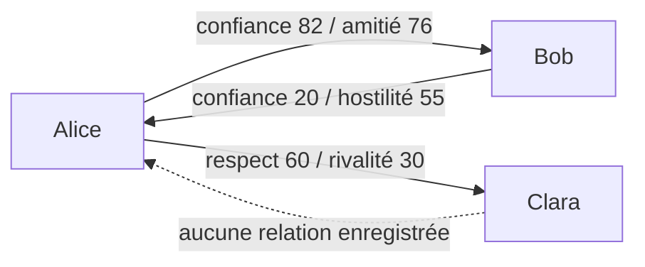

# Système de relations — conception Phase 2 (implémentation [Planifié])

> **Statut : proposition architecturale. Aucune table, aucun service, aucun IPC et aucun
> comportement relationnel n'est implémenté à ce jour.** L'état réel du projet est décrit
> dans `docs/CHARACTER_SYSTEM.md` et `docs/DATABASE.md` : les personnages n'ont aujourd'hui
> aucune donnée de relation. Ce document remplace la note courte « [Planifié, phase 4] »
> par un contrat exploitable, sans modifier le code.

## 1. Principe fondamental : asymétrie

Une relation est **directionnelle** : `A → B` est stockée et évolue indépendamment de
`B → A`. A peut considérer B comme un ami proche alors que B ne voit en A qu'une
connaissance — et c'est une information légitime, pas une incohérence.



**Règle d'absence** : l'absence de ligne `A → B` signifie « aucune relation établie »
(neutre, non évaluée), pas « A déteste B ». Aucune valeur par défaut n'est appliquée
aux images ; le moteur doit créer la ligne explicitement lors d'une première interaction.
Cela évite de peupler `N²` lignes inutiles et rend les décisions explicables.

## 2. Dimensions relationnelles proposées

Toutes les dimensions sont des **entiers 0-100**, validés comme les autres scores du projet.
Une valeur neutre de référence est 50 pour les dimensions bipolaires, 0 pour les dimensions
exclusivement négatives.

| Dimension | Sémantique | Pôle neutre | Remarque |
|---|---|---|---|
| `trust` (confiance) | Fiabilité perçue, tolérance à la vulnérabilité | 50 | Baisse fortement sur trahison, lentement récupérable. |
| `friendship` (amitié) | Proximité sociale souhaitée | 0 | 0 = inconnu, 100 = meilleur ami. |
| `affection` (affection) | Attachement émotionnel / tendresse | 0 | Différente de l'amitié (peut exister dans la famille, le couple). |
| `respect` (respect) | Estime pour les actions et compétences | 50 | Alimenté par actes de courage/aide, détruit par lâcheté. |
| `attraction` (attirance) | Intérêt romantique/sensoriel | 0 | Indépendant de l'affection. |
| `rivalry` (rivalité) | Compétition, comparaison | 0 | Peut coexister avec le respect. |
| `hostility` (hostilité) | Agression / animosité | 0 | Différente de la rivalité. |
| `fear` (peur) | Crainte de l'autre | 0 | Peut exister même avec confiance faible/amitié forte. |
| `resentment` (ressentiment) | Rancœur accumulée | 0 | Persiste plus longtemps que la colère ponctuelle. |

> **Décision à valider avant implémentation** : conserver les 9 dimensions du document
> initial (ajout de `attraction`, `fear`, `resentment` par rapport à la liste minimale
> demandée : confiance, amitié, affection, respect, rivalité, hostilité). Une réduction
> à 6 dimensions est possible si le coût d'équilibrage se révèle trop élevé ; le nom des
> champs reste alors le même pour ne pas réécrire les règles.

### Types dérivés (calculés, non stockés)

`Inconnu` (aucune ligne), `Connaissance` (friendship 1-29), `Ami` (30-59), `Ami proche`
(60-84), `Meilleur ami` (85+), `Amoureux` (affection/attraction élevées), `En couple`
(statut explicite **[Planifié]**), `Rival` (rivalité > 60 et hostilité < 40),
`Ennemi` (hostilité > 60). Le type dérivé est une **fonction pure** des dimensions et
d'éventuels drapeaux ; le moteur ne doit jamais écrire un champ `type` qui pourrait
devenir incohérent avec les scores.

## 3. Structure de données proposée

### 3.1 Types TypeScript (`src/shared/relationship.ts` — [Planifié], aucun code Node)

```ts
export type RelationshipDimension =
  | 'trust' | 'friendship' | 'affection' | 'respect' | 'attraction'
  | 'rivalry' | 'hostility' | 'fear' | 'resentment';

export type RelationshipScores = Record<RelationshipDimension, number>; // 0-100

/** Une ligne = l'avis de `ownerId` sur `targetId`. Jamais de ligne symétrique implicite. */
export interface Relationship {
  id: string;                 // UUID
  worldId: string;            // isolation stricte par monde
  ownerId: string;            // personnage qui porte l'avis
  targetId: string;           // personnage observé
  scores: RelationshipScores;
  /** Dernier tick où une interaction a modifié cette relation. */
  lastInteractionTick: number;
  createdAtTick: number;
  updatedAtTick: number;
  /** Aparté : drapeaux explicites (couple, membre de la même famille, etc.). */
  flags: Array<'couple' | 'family' | 'former_friend'>;
}

/** Modification calculée par une règle, avant application transactionnelle. */
export interface RelationshipDelta {
  ownerId: string;
  targetId: string;
  changes: Partial<RelationshipScores>;
  reason: string;             // explicabilité obligatoire
  sourceEventId?: string;
}
```

### 3.2 Table SQLite additive proposée (`relationships` — [Planifié], à ne pas créer maintenant)

| Colonne | Type | Notes |
|---|---|---|
| `id` | TEXT PK | UUID |
| `world_id` | TEXT NOT NULL | FK → `worlds(id) ON DELETE CASCADE` |
| `owner_id` | TEXT NOT NULL | FK → `characters(id) ON DELETE CASCADE` |
| `target_id` | TEXT NOT NULL | FK → `characters(id) ON DELETE CASCADE` |
| `scores_json` | TEXT NOT NULL | objet `RelationshipScores`, validé main |
| `flags_json` | TEXT NOT NULL DEFAULT '[]' | liste de drapeaux |
| `last_interaction_tick` | INTEGER NOT NULL DEFAULT 0 | temps interne, pas `Date.now()` |
| `created_at_tick` / `updated_at_tick` | INTEGER NOT NULL | traçabilité |
| `created_at` / `updated_at` | TEXT NOT NULL | dates réelles d'écriture, diagnostic |

Contrainte d'unicité : `UNIQUE(world_id, owner_id, target_id)` et index
`idx_relationships_world_owner (world_id, owner_id)`. Un couple asymétrique occupe donc
**deux lignes**. Auto-relations (`owner_id = target_id`) refusées par validation main.

**Aucune migration n'est à faire dans cette tranche.** Quand la table sera créée (phase 4),
elle sera `CREATE TABLE IF NOT EXISTS` en complément du schéma actuel — aucune colonne
existante ne sera modifiée. Les bases sans relations restent parfaitement lisibles.

### 3.3 Exemples concrets

1. **Aide inattendue** : Bob aide Alice lors d'une crise. Règle : `A→B.trust +12`,
   `A→B.friendship +6`, `A→B.affection +2` ; si un témoin Clara observe,
   `C→B.respect +5`. Bob ne change rien de ce qu'il ressent envers Alice : aucune
   écriture `B→A` sans événement qui le justifie.
2. **Trahis** : Alice révèle un secret de Bob. `B→A.trust -40`, `B→A.respect -25`,
   `B→A.resentment +30`, `B→A.friendship -20`. `A→B` reste inchangé sauf si Alice
   prend conscience de sa faute (événement distinct).
3. **Jalousie** : Clara voit Bob félicité par Alice. `C→A.resentment +8`,
   `C→B.rivalry +10`, émotion `envie/jalousie` modifiée côté C, aucune modification
   des lignes de A ou B.
4. **Érosion par absence** : après `N` ticks sans interaction, `friendship -1` par
   période, jusqu'à un plancher ; `trust` et `resentment` ne s'érodent pas
   automatiquement. `N` et le rythme sont des **paramètres à calibrer**, pas des
   valeurs arrêtées ici.
5. **Décès (phase 5)** : les relations du défunt sont conservées en lecture seule ;
   les survivants voient leurs propres lignes évoluer selon le deuil. Aucune suppression
   en cascade des avis portant sur un mort.

### 3.4 Règles d'intégrité

- Toute écriture passe par un service main unique (`relationship.service.ts` **[Planifié]**),
  jamais par le renderer.
- Une modification de relation est **toujours** causée par un événement ou une règle de
  décroissance explicitement documentée ; jamais par un tirage aléatoire isolé.
- Les événements de changement de relation sont enregistrés dans l'historique
  (voir `docs/EVENT_AND_MEMORY_SYSTEM.md`) avec avant/après et tick.
- Les scores sont validés (entiers 0-100, clés exactes) avant persistance — mêmes
  conventions que `character-validation.service.ts`.
- Une écriture de tick inclut personnages + relations + événements dans **une seule
  transaction** ; un échec annule tout.
- Le PRNG utilisé par les règles est le PRNG métier seedé du monde, jamais `Math.random()`
  ni un générateur lié au LLM.
- Le temps utilisé est `tick`, jamais l'horloge système, pour garantir la reproductibilité.

## 4. Questions ouvertes

- Faut-il une table `relationship_events` séparée ou suffit-il de l'événement global avec
  `before/after` ? Proposition : événement global + `delta` sérialisé, pas de table
  supplémentaire (moins de jointures, traçabilité suffisante).
- Comment représenter « A ne connaît pas encore B » sans créer de ligne : absence de ligne
  retenue (voir §1). À confirmer lors de la conception des règles de rencontre.
- Faut-il un plafond de lignes par personnage ? Oui pour la performance : capacité
  d'interaction limitée par le moteur, pas par la structure de données. À calibrer.
- Le graphe UI (phase 7) devra gérer les arêtes asymétriques (deux flèches ou paires de
  couleurs) ; à concevoir avec l'UI, sans stub maintenant.

## Liens

- `docs/CHARACTER_STATE_ARCHITECTURE.md` — frontière état stable / dynamique.
- `docs/EVENT_AND_MEMORY_SYSTEM.md` — cause des changements relationnels et souvenirs.
- `docs/SIMULATION_TIME_AND_ENGINE.md` — tick, ordre, déterminisme, sauvegarde.
- `docs/DATABASE.md` — schéma réel et règles de migration.
