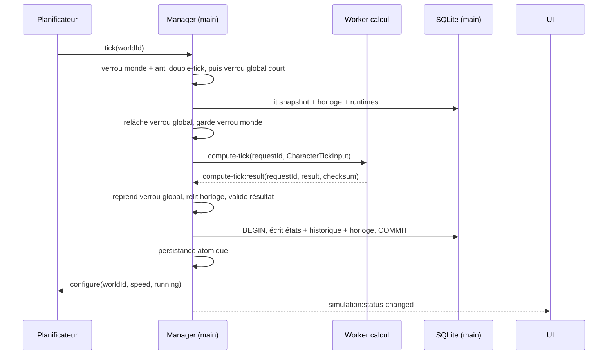

# Protocole de calcul du tick dans un worker — [Planifié, Phase 3D]

> Aucun worker, message ou contrat décrit ici n'est implémenté par cette tranche
> documentaire. Le worker actuel `simulation.worker.ts` reste un planificateur de ticks :
> il ne calcule aucune règle métier et n'ouvre aucune base SQLite.

## 1. Architecture retenue

Deux workers aux responsabilités séparées :

| Worker | Fichier | Responsabilité | Accès SQLite |
|---|---|---|---|
| Planificateur | `src/main/simulation/simulation.worker.ts` | `setInterval` par monde, signaux `tick`, vitesse | aucun |
| Calcul | `src/main/simulation/tick-compute.worker.ts` | `computeCharacterTick()` et règles pures uniquement | aucun |

Le second worker est ajouté en 3D-C. Le premier n'est pas modifié dans son principe. Le main reste propriétaire de SQLite et de la validation finale.



## 2. Contrats TypeScript proposés

```ts
interface ComputeTickRequest {
  type: 'compute-tick';
  protocolVersion: 1;
  requestId: string;          // monotone côté manager
  input: CharacterTickInput;  // contrat existant, inchangé
}

type ComputeTickResponse =
  | {
      type: 'compute-tick:result';
      protocolVersion: 1;
      requestId: string;
      worldId: string;
      tick: number;
      result: CharacterTickResult;
      checksum: string;       // SHA-256 du JSON canonique du résultat
      versions: {
        engineVersion: string;
        registryVersion: number;
        parametersVersion: number;
      };
    }
  | {
      type: 'compute-tick:error';
      protocolVersion: 1;
      requestId: string;
      worldId?: string;
      code: 'invalid_input' | 'compute_error' | 'unsupported_version';
      message: string;
    };
```

`CharacterTickInput` et `CharacterTickResult` restent définis dans `src/shared/simulation-rules.ts`. Le protocole ajoute une enveloppe, il ne modifie pas les règles.

Un message inconnu, une version de protocole inconnue ou un champ manquant produit `unsupported_version` ou `invalid_input`, jamais une tentative d'interprétation tolérante.

## 3. Identifiants de requête et concurrence

- `requestId` est généré par un compteur local du manager : `compute-1`, `compute-2`, …
- Aucun UUID n'est utilisé : il n'est pas nécessaire et il n'apporterait qu'une dépendance à un aléa non simulé.
- Le compteur n'est pas persisté : il sert uniquement à corréler messages dans la session courante.
- `pendingComputes: Map<string, PendingCompute>` associe `requestId` à `{ input, expected, resolve, reject, timer }`, où `expected` contient au minimum `{ worldId, tick, day, hour, rngState }` tels que lus dans l'horloge avant le calcul.
- Le verrou du monde reste actif pendant tout le tick. L'ordre est toujours **monde → global** : le verrou global est pris pour lire le snapshot puis relâché avant `compute-tick` ; il est repris après la réponse pour relire l'horloge, valider `expected`, écrire et persister.
- Plusieurs mondes peuvent avoir des requêtes en attente ; le worker les traite séquentiellement dans son event loop. Le main corrèle exclusivement par `requestId`.
- Le checksum est calculé sur un JSON canonique produit par un utilitaire pur partagé (clés triées récursivement, tableaux dans l'ordre métier, aucun horodatage). Le main recalcule le même hash après réception ; le hash du worker n'est jamais une preuve suffisante.

## 4. Validation dans le main

Avant toute écriture, le main vérifie :

1. `requestId` existe dans `pendingComputes` et n'a pas déjà été résolu ;
2. `worldId`, `tick`, `day`, `hour`, `rngState` initiaux correspondent à la requête et à l'horloge relue ;
3. le monde existe toujours et n'a pas été supprimé ;
4. le nombre d'états, de runtimes, de décisions et d'enregistrements d'historique correspond au nombre de personnages du snapshot ;
5. chaque `characterId` est unique et présent dans le snapshot ;
6. chaque action sélectionnée appartient à `ACTION_IDS` ;
7. `rngState` résultant est un uint32 ;
8. toutes les valeurs sont finies, les besoins/émotions dans `[0, 100]` ;
9. le checksum fourni correspond au JSON canonique calculé côté main ;
10. les versions annoncées correspondent à celles utilisées par le main.

Toute divergence lève une erreur technique. Le tick est rollbacké sans écriture partielle.

## 5. Erreurs, doublons et réponses tardives

| Situation | Comportement |
|---|---|
| Message invalide du worker | Rejet de la requête correspondante, journalisation, aucun état écrit. |
| Réponse avec `requestId` inconnu | Ignorée et journalisée. |
| Deux réponses pour le même `requestId` | La première est acceptée ; la seconde est ignorée et journalisée. |
| Réponse après timeout | Ignorée ; la requête est déjà rejetée. |
| Monde supprimé pendant le calcul | Requête annulée ; réponse ignorée ; verrou libéré sans écriture. |
| Erreur de calcul sur `step` manuel | Rejet de l'appel IPC ; aucun état écrit, aucun retry automatique. |
| Erreur de calcul sur tick automatique | Journalisation dans le main, aucun état écrit, statut diffusé inchangé, aucun retry automatique. |
| Worker `error` | Requêtes en attente rejetées ; worker considéré indisponible. |
| Worker `exit` | Toutes les requêtes en attente rejetées ; map vidée ; worker recréé au prochain signal de tick ou à la prochaine commande active qui en a besoin. `simulationGetStatus()` ne le recrée pas. |
| Tick manqué pendant panne | Aucun rattrapage automatique ; le prochain signal du planificateur produit un seul tick normal. |

Le délai initial proposé est de **30 s**. Il doit être configuré sans dépendre d'`Date.now()` dans les règles : la date n'est utilisée que pour mesurer le timeout dans le main.

## 6. Redémarrage du worker

À la recréation du worker de calcul :

1. le manager attend le message `ready` avant de poster une requête ;
2. les requêtes en attente de l'ancienne génération sont déjà rejetées ;
3. aucun état SQLite n'est réécrit automatiquement ;
4. les clocks `running` restent inchangés : la planification existante continue d'envoyer des signaux ;
5. `ensureComputeWorker()` est appelé au prochain signal `tick` ou à la prochaine commande active nécessitant un calcul, jamais par `simulationGetStatus()` ;
6. si le worker de calcul meurt alors qu'aucune requête n'est en attente, aucune action utilisateur n'est requise.

Cette politique évite un double tick : une panne ne déclenche ni rejeu ni compensation invisible.

## 7. Déterminisme et Golden Hash

Le hachage de référence porte sur le **JSON canonique** du résultat : clés triées récursivement, tableaux dans leur ordre métier, nombres sérialisés sans virgule flottante parasite, aucun horodatage.

Tests Golden Hash à prévoir :

- seeds : plusieurs valeurs fixes, dont la seed utilisée dans les tests de réouverture ;
- profils : les 6 profils définis dans `tests/simulation-rules-fixtures.ts` et consommés par `tests/simulation-long.test.ts` ;
- effectifs : 1, 2, 10 et 50 personnages ;
- horizons : 24, 72, 168 et 720 ticks ;
- comparaison : `computeCharacterTick()` direct en main (référence Phase 3C) contre le worker.

Le calcul direct de référence est conservé dans les tests, pas dans le chemin de production. Aucun mode « tantôt main, tantôt worker » n'est accepté en production.

## 8. Refus explicites

- Aucun accès SQLite dans le worker de calcul.
- Aucun appel IPC, réseau, LLM ou `safeStorage`.
- Aucune lecture de `Date.now()` ou `Math.random()` dans les règles.
- Aucune écriture de fichier.
- Aucune mutation d'un état global du worker entre deux requêtes : chaque réponse dépend uniquement de son `input`.

## 9. Tests prévus

**Unitaires worker**

- messages valides/invalides, versions inconnues, champs manquants ;
- déterminisme sur entrée identique ;
- absence d'état résiduel entre deux requêtes.

**Intégration manager**

- corrélation par `requestId`, doublons, réponses tardives, timeout ;
- deux mondes avec requêtes imbriquées ;
- suppression d'un monde pendant un calcul ;
- crash et recréation du worker ;
- golden hash contre la référence Phase 3C.

**Electron**

- step manuel, start/pause/resume à 1x/10x ;
- aucun blocage visible pendant un tick avec 50 personnages ;
- statut diffusé une seule fois par tick réussi.

## 10. Hors périmètre

Exécution de la transaction dans le worker, déplacement de sql.js, calcul d'événements Phase 5, arbitrage de ressources Phase 4, génération de dialogues, compression des résultats.
