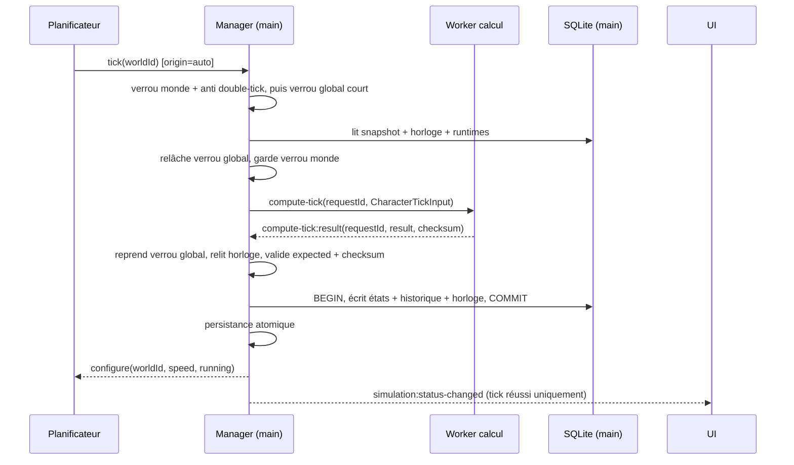

# Protocole de calcul du tick dans un worker — Phase 3D-C

> **Arbitrages définitifs validés le 2026-11-26 ; 3D-C1 et 3D-C2 implémentées et validées.**
> Les contrats, validateurs et le worker autonome existent, mais **le worker n'est pas branché
> sur la production** : le calcul reste synchrone dans le main jusqu'à 3D-C3, qui exige une
> validation explicite distincte. Le worker actuel `simulation.worker.ts` reste un planificateur
> de ticks : il ne calcule aucune règle métier et n'ouvre aucune base SQLite.
> `docs/PHASE_3D_DESIGN.md` §2.1 et §10 font autorité.

## 1. Architecture retenue

Deux workers aux responsabilités séparées :

| Worker | Fichier | Responsabilité | Accès SQLite |
|---|---|---|---|
| Planificateur | `src/main/simulation/simulation.worker.ts` | `setInterval` par monde, signaux `tick`, vitesse | aucun |
| Calcul | `src/main/simulation/tick-compute.worker.ts` | `computeCharacterTick()` et règles pures uniquement | aucun |

Le second worker est ajouté en 3D-C2 sous forme de module autonome, sans branchement. Le premier n'est pas modifié dans son principe. Le main reste propriétaire de SQLite et de la validation finale. Le calcul direct Phase 3C reste le chemin de production jusqu'à 3D-C3 : aucun mode hybride ni repli silencieux n'est accepté.



`origin: 'auto' | 'manual'` est un marqueur **interne au manager** : il n'ajoute aucun canal IPC et aucun champ au protocole worker. Un `step` manuel emprunte le même calcul mais propage les erreurs à l'appelant IPC.

## 2. Contrats TypeScript implémentés (3D-C1)

```ts
interface ComputeTickRequest {
  type: 'compute-tick';
  protocolVersion: 1;
  requestId: string;          // monotone côté manager : compute-1, compute-2, …
  input: CharacterTickInput;  // contrat existant, inchangé
}

type ComputeTickResponse =
  | {
      type: 'compute-tick:result';
      protocolVersion: 1;
      requestId: string;
      worldId: string;
      tick: number;
      result: CharacterTickResult;
      checksum: string;       // SHA-256 du noyau Golden Hash (§7), sans decisionRecords
      versions: {
        engineVersion: string;
        registryVersion: number;
        parametersVersion: number;
      };
    }
  | {
      type: 'compute-tick:error';
      protocolVersion: 1;
      requestId: string;
      worldId?: string;
      code: 'invalid_input' | 'compute_error' | 'unsupported_version';
      message: string;
    };
```

`CharacterTickInput` et `CharacterTickResult` restent définis dans `src/shared/simulation-rules.ts`. Le protocole ajoute une enveloppe, il ne modifie pas les règles.

- `protocolVersion = 1` est la seule version acceptée. Un message inconnu, une version inconnue ou un champ manquant produit `invalid_input` ou `unsupported_version`, jamais une interprétation tolérante.
- Une erreur `unsupported_version` reste corrélée par `requestId` lorsque le message est lisible ; sinon elle est journalisée sans corrélation. Son champ `protocolVersion` porte la version reçue si elle est lisible, sinon `1`.
- Le checksum ne couvre pas `decisionRecords` (arbitrage P2). Ceux-ci sont validés séparément dans le main (§4).

## 3. Identifiants de requête et concurrence

- `requestId` est généré par un compteur local du manager : `compute-1`, `compute-2`, …
- Aucun UUID n'est utilisé : il n'est pas nécessaire et il n'apporterait qu'une dépendance à un aléa non simulé.
- Le compteur n'est pas persisté : il sert uniquement à corréler les messages de la session courante.
- `pendingComputes: Map<string, PendingCompute>` associe `requestId` à `{ input, expected, resolve, reject, timer }`.
- `expected = { worldId, tick, day, hour, rngState }` : `tick = clock.tick + 1`, `day`/`hour` étant **dérivés de ce tick** par `deriveDayHour()` (et non de l'ancienne ligne d'horloge), et `rngState = clock.rngState` lu avant le calcul. `CharacterTickResult` ne porte pas `day`/`hour` : la validation compare l'enveloppe, l'`input`, les `explanation` et l'horloge relue (§4).
- Le verrou du monde reste actif pendant tout le tick et couvre toute écriture ciblant ce monde (arbitrage P1). L'ordre est toujours **monde → global** : le verrou global est pris pour lire le snapshot puis relâché avant `compute-tick` ; il est repris après la réponse pour relire l'horloge, valider `expected`, exporter `beforeBuffer`, écrire et persister.
- Plusieurs mondes peuvent avoir des requêtes en attente ; le worker de calcul unique les traite séquentiellement dans son event loop. Le main corrèle exclusivement par `requestId`.
- Le checksum est calculé sur la sérialisation canonique du noyau défini en §7 par l'utilitaire pur partagé. Le main recalcule le même hash après réception ; le hash fourni par le worker n'est jamais une preuve suffisante. `payloadSha256` de l'historique des décisions reste une notion distincte, calculée dans le main à l'insertion.
- Le délai d'attente est une **constante fixe de 30 s** (arbitrage P8), sans surface de configuration. L'entrée `pending` est **retirée de la map avant le rejet**, afin qu'une réponse ultérieure ne puisse pas être acceptée. Aucun retry automatique ni compensation de tick manqué.

## 4. Validation dans le main

Avant toute écriture, le main vérifie :

1. `requestId` existe dans `pendingComputes`, n'a pas déjà été résolu et le monde n'a pas été supprimé ;
2. l'horloge relue donne `tick === expected.tick - 1` et `rngState === expected.rngState`, et `worldId` correspond ;
3. l'enveloppe porte les mêmes `worldId` et `tick` que `result`, et chaque `explanation` porte `worldId`, `tick`, `day` et `hour` cohérents avec `expected` ;
4. le nombre d'états, de runtimes, de décisions et d'enregistrements d'historique correspond au nombre de personnages du snapshot ;
5. chaque `characterId` est unique et présent dans le snapshot ;
6. chaque action sélectionnée appartient à `ACTION_IDS` ;
7. `rngState` résultant est un uint32 ;
8. toutes les valeurs sont finies, les besoins/émotions dans `[0, 100]` ;
9. le checksum fourni correspond au noyau Golden Hash recalculé côté main avec la définition du §7 ;
10. les versions annoncées correspondent à celles utilisées par le main ;
11. bien que `decisionRecords` soit exclu du checksum, chaque enregistrement passe par `validateDecisionRecordPayload()` et son `characterName` reste cohérent avec `input.characterNameByCharacterId`.

Toute divergence lève une erreur technique. Le tick est rollbacké sans écriture partielle. Aucune transaction n'est ouverte pendant l'attente du worker.

## 5. Erreurs, doublons et réponses tardives

| Situation | Comportement |
|---|---|
| Message invalide du worker | Rejet de la requête correspondante, retrait de `pendingComputes`, journalisation, aucun état écrit. |
| Réponse avec `requestId` inconnu ou déjà résolu | Ignorée et journalisée. |
| Deux réponses pour le même `requestId` | La première est acceptée et l'entrée est retirée ; la seconde est ignorée et journalisée. |
| Réponse après timeout | Ignorée ; la requête a déjà été rejetée et son entrée retirée. |
| Monde supprimé pendant le calcul | Tombeau et annulation immédiats avant les verrous ; réponse ignorée ; aucun tick écrit. |
| Erreur de calcul sur `step` manuel | Rejet de l'appel IPC ; aucun état écrit, aucun retry automatique. |
| Erreur de calcul sur tick automatique | Journalisation dans le main, aucun état écrit, statut inchangé en valeur, aucun retry automatique. |
| Worker `error` | Toutes les requêtes en attente sont rejetées, la map est vidée, le worker est considéré indisponible. |
| Worker `exit` | Toutes les requêtes en attente sont rejetées, la map est vidée, le worker est recréé au prochain signal de tick ou à la prochaine commande active qui en a besoin. |
| Tick manqué pendant panne | Aucun rattrapage automatique ; le prochain signal du planificateur produit un seul tick normal. |

Les trois délais de 30 s (attente du verrou du monde, file d'écriture globale, calcul worker) restent indépendants. L'annulation à la suppression ne dépend pas de l'acquisition d'un verrou, afin qu'un timeout ne laisse pas une requête pending.

## 6. Redémarrage du worker

À la recréation du worker de calcul :

1. le manager attend le message `ready` avant de poster une requête ;
2. les requêtes en attente de l'ancienne génération sont déjà rejetées et retirées de la map ;
3. aucun état SQLite n'est réécrit automatiquement ;
4. les clocks `running` restent inchangés : la planification existante continue d'envoyer des signaux ;
5. `ensureComputeWorker()` est appelé au prochain signal `tick` ou à la prochaine commande active nécessitant un calcul, jamais par `simulationGetStatus()` (arbitrage P7) ;
6. si le worker de calcul meurt alors qu'aucune requête n'est en attente, aucune action utilisateur n'est requise.

Cette politique évite un double tick : une panne ne déclenche ni rejeu ni compensation invisible. Le worker planificateur et le worker de calcul ont des durées de vie strictement distinctes.

## 7. Déterminisme, noyau haché et Golden Hash

### 7.1 Définition du noyau (arbitrage P2)

Le checksum du protocole porte sur le **noyau Golden Hash historique** : exactement les champs `worldId`, `tick`, `rngState`, `characterStates`, `deltas`, `decisions`, `actionDeltas`, `actionRuntimeStates` et `warnings` de `CharacterTickResult`. **`decisionRecords` est exclu** : les 18 valeurs de référence de `tests/decision-golden-hash.test.ts` restent inchangées.

La sérialisation canonique est celle utilisée pour ces valeurs de référence : clés triées récursivement, tableaux dans leur ordre métier, `JSON.stringify(value) ?? 'null'` pour toute valeur non-objet (dont `undefined`, `NaN` et l'infini), aucun horodatage. Le hash est un SHA-256 hexadécimal du JSON canonique encodé en UTF-8. Cette fonction est fournie depuis 3D-C1 par `src/shared/canonicalization.ts` (`canonicalizeGoldenTickResult()`) ; le test Golden Hash utilise désormais cette source unique **sans modifier les 18 hashes attendus**. `decisionRecords` est exclu du checksum du protocole mais reste transmis au main pour validation.

Trois notions restent distinctes :

- le **checksum du protocole** porte sur le noyau ci-dessus et sert de contrôle de transport ;
- le **`payloadSha256`** couvre une charge utile de décision complète et est calculé dans le main à l'insertion dans `decision_records`, avec le canonicaliseur strict qui refuse `undefined` et les nombres non finis ;
- le **Golden Hash de test** est la comparaison de non-régression entre calcul direct et calcul worker, sur le même noyau que le checksum.

### 7.2 Matrice de tests

- **Suite ordinaire** : les 18 scénarios existants, soit 6 profils × 1 personnage × 720 ticks, puis 1/2/10/50 personnages × 24/72/168/720 ticks sur le profil `optimiste résilient`.
- **Test long isolé** : matrice complète 6 profils × 1/2/10/50 personnages × 24/72/168/720 ticks.
- **Seeds** : plusieurs valeurs fixes, dont `0xc0ffee` et la seed utilisée dans les tests de réouverture. Les nouvelles valeurs de la matrice complète sont ajoutées comme références supplémentaires, jamais substituées aux 18 historiques.
- **Comparaison** : `computeCharacterTick()` direct en main (référence Phase 3C) contre le worker. Le calcul direct reste dans les tests, pas dans le chemin de production.

## 8. Refus explicites

- Aucun accès SQLite dans le worker de calcul.
- Aucun appel IPC, réseau, LLM ou `safeStorage`.
- Aucune lecture de `Date.now()` ou `Math.random()` dans les règles.
- Aucune écriture de fichier.
- Aucune mutation d'un état global du worker entre deux requêtes : chaque réponse dépend uniquement de son `input`.
- Aucune dépendance Node dans les règles ou les utilitaires partagés ; seul le calcul du checksum de transport peut utiliser `node:crypto` dans le worker Node, avec vérification systématique côté main.
- Aucune option de configuration du timeout : la valeur est la constante validée de 30 s.

## 9. Tests

**Unitaires worker — réalisés en 3D-C2**

- messages valides/invalides, versions inconnues, champs manquants ;
- déterminisme sur entrée identique ;
- absence d'état résiduel entre deux requêtes ;
- checksum conforme au noyau du §7, avec `decisionRecords` exclu.

**Intégration manager — prévue en 3D-C3**

- corrélation par `requestId`, doublons, réponses tardives, timeout ;
- retrait de l'entrée `pending` avant rejet, puis ignorance de la réponse tardive ;
- deux mondes avec requêtes imbriquées ;
- suppression d'un monde pendant un calcul, tombeau et annulation avant verrous ;
- crash `error`/`exit`, rejet des requêtes et recréation paresseuse ;
- propagation d'erreur : `step` manuel rejeté, tick automatique journalisé sans écriture ;
- Golden Hash : 18 scénarios en suite ordinaire, matrice complète en test long isolé.

**Electron [Planifié 3D-C3/3D-D]**

- step manuel, start/pause/resume à 1x/10x ;
- aucun blocage visible pendant un tick avec 50 personnages ;
- statut diffusé une seule fois par tick réussi.

## 10. Hors périmètre

Exécution de la transaction dans le worker, déplacement de sql.js, calcul d'événements Phase 5, arbitrage de ressources Phase 4, génération de dialogues, compression des résultats, configuration du timeout, optimisation opportuniste de la persistance.
